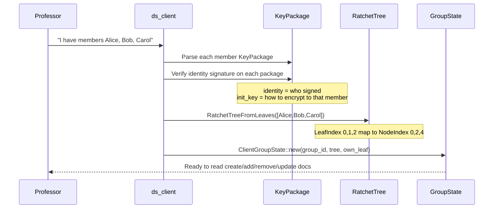

# Introduction: MLS Basics (Professor-Friendly)

## Formal Setup
This page explains the first concepts needed before reading action docs.

Let:
- $KP$ be a KeyPackage.
- $\text{identity}$ be the member identity verification key (used to verify who signed).
- $\text{init\_key}$ be the member encryption public key (used to encrypt to that member).
- $L_i$ be leaf $i$ in the tree (one member per leaf).
- $n_j$ be node index $j$ in the same tree array.
- $\mathrm{leaf\_to\_node}(i)=2i$.
- $\mathrm{node\_to\_leaf}(j)=j/2$ if $j$ is even; undefined if $j$ is odd.

Plain-language meanings:
- `identity`: "Who am I?" key (signature verification identity).
- `init_key`: "How to encrypt to me?" key (hybrid KEM public key).
- `RatchetTreeFromLeaves`: "Build the MLS tree from an ordered member list."

RFC 9420 Basis:
- KeyPackage, tree leaves/parents, and indexed ratchet-tree structure are core MLS concepts.
- This document is a learning primer, not a standalone wire action.

Suspicious Findings:
- Local bootstrap can create group state before a Commit/Welcome wire exchange.
- Member order supplied by CLI controls leaf indices, so different ordering changes index numbers.

## Mathematical Flow
1. Define one member package
   Inputs: identity verification key, init encryption key, signature
   Outputs: key package $KP$
   Equation:
   $$
   KP=(\text{identity},\text{init\_key},\sigma)
   $$
   Example: "Alice's package" contains Alice identity key + Alice init encryption key + signature.
   RFC 9420 Basis: KeyPackage structure.
   Suspicious Finding: None.

2. Verify a key package before trusting it
   Inputs: $KP$
   Outputs: trusted / rejected
   Equation:
   $$
   \mathrm{Verify}(KP)\in\{0,1\}
   $$
   Example: if $\mathrm{Verify}(KP)=0$, do not place this member in the tree.
   RFC 9420 Basis: KeyPackage signature validation.
   Suspicious Finding: None.

3. Convert verified packages to leaves
   Inputs: verified $(KP_0,\dots,KP_{m-1})$
   Outputs: ordered leaves $(L_0,\dots,L_{m-1})$
   Equation:
   $$
   L_i=(KP_i.\text{init\_key},KP_i.\text{identity})
   $$
   Example: order `[Alice, Bob, Carol]` means `LeafIndex 0=Alice`, `1=Bob`, `2=Carol`.
   RFC 9420 Basis: leaf credential/key binding.
   Suspicious Finding: Order-dependent indexing can confuse operators if not fixed by policy.

4. Build the ratchet tree from leaves
   Inputs: $(L_0,\dots,L_{m-1})$
   Outputs: tree $T$
   Equation:
   $$
   T=\mathrm{RatchetTreeFromLeaves}(L_0,\dots,L_{m-1})
   $$
   Example: for 3 leaves, node indices are typically `0,2,4` for leaves and odd indices for parents.
   RFC 9420 Basis: ratchet-tree construction model.
   Suspicious Finding: None.

5. Understand LeafIndex vs NodeIndex
   Inputs: leaf index $i$ or node index $j$
   Outputs: converted index
   Equation:
   $$
   \mathrm{leaf\_to\_node}(i)=2i
   $$
   $$
   \mathrm{node\_to\_leaf}(j)=
   \begin{cases}
   j/2 & j \bmod 2=0\\
   \bot & j \bmod 2=1
   \end{cases}
   $$
   Example:
   - `LeafIndex 0 -> NodeIndex 0`
   - `LeafIndex 1 -> NodeIndex 2`
   - `NodeIndex 3` is parent, not a leaf
   RFC 9420 Basis: left-balanced in-order indexing.
   Suspicious Finding: None.

6. Initialize first local group state
   Inputs: group id $g$, tree $T$, own leaf index $o$
   Outputs: local state $S_0$
   Equation:
   $$
   S_0=\mathrm{ClientGroupState::new}(g,T,o),\quad \mathrm{epoch}(S_0)=0
   $$
   Human meaning: this is the local starting snapshot before add/remove/update actions.
   RFC 9420 Basis: group-state and epoch-0 key schedule initialization primitives.
   Suspicious Finding: This can be local-only before network commit/welcome synchronization.

## Protocol Visual (Mermaid)

## Implementation Traceability
| Symbol/Equation | File:Line | Function Name |
|---|---|---|
| $KP=(\text{identity},\text{init\_key},\sigma)$ | `src/tree.rs:270` | `KeyPackage` |
| $\mathrm{Verify}(KP)$ | `src/tree.rs:281` | `KeyPackage::verify` |
| $L_i=(KP_i.\text{init\_key},KP_i.\text{identity})$ | `src/bin/ds_client.rs:1684` | `leaf_from_keypackage` |
| $T=\mathrm{RatchetTreeFromLeaves}(\cdot)$ | `src/tree.rs:648` | `RatchetTree::from_leaves` |
| $\mathrm{leaf\_to\_node}(i)=2i$ (rule) | `src/tree.rs:42` | `RatchetTree` (indexing comment) |
| $\mathrm{leaf\_to\_node}(i)$ API | `src/tree.rs:753` | `RatchetTree::leaf_to_node_index` |
| $\mathrm{node\_to\_leaf}(j)$ API | `src/tree.rs:757` | `RatchetTree::node_to_leaf_index` |
| $S_0=\mathrm{ClientGroupState::new}(g,T,o)$ | `src/client_state.rs:44` | `ClientGroupState::new` |
| bootstrap entry point for this project flow | `src/bin/ds_client.rs:75` | `Commands::BootstrapGroupState` |
| `SUSPICIOUS: local bootstrap may exist before Commit/Welcome exchange` | `src/bin/ds_client.rs:522` | `main` (BootstrapGroupState arm) |
| `SUSPICIOUS: member input order determines leaf indices` | `src/bin/ds_client.rs:540` | `main` (BootstrapGroupState arm) |
