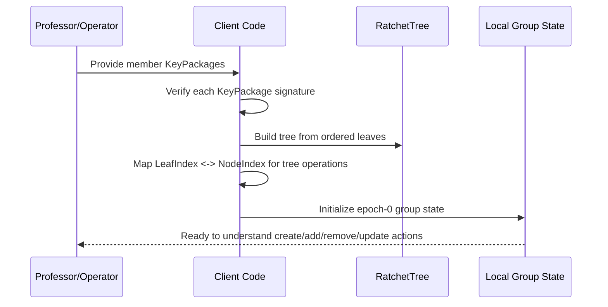

# Introduction: MLS Basics For This Project

## Formal Setup
Let:
- $KP$ be a `KeyPackage` (identity + init key + signature).
- $L_i$ be leaf $i$ in a ratchet tree.
- $n_i$ be node index $i$ in the left-balanced tree representation.
- $\mathrm{leaf\_to\_node}(i)=2i$.
- $\mathrm{node\_to\_leaf}(j)=j/2$ if $j$ is even; undefined if $j$ is odd.

RFC 9420 Basis:
- `KeyPackage`, ratchet tree leaves/parents, and indexed tree structure are RFC 9420 core concepts.
- This document is a learning primer for understanding later action-level docs; it is not a wire-protocol action by itself.

Suspicious Findings:
- Local bootstrap flows in this codebase can initialize group state without a full Commit/Welcome wire exchange.
- Member order passed by operator/CLI can affect leaf indices, which can confuse non-technical readers if not explained early.

## Mathematical Flow
1. KeyPackage means “who I am” + “how to encrypt to me”
   Inputs: identity public key, init public key, signature
   Outputs: verified or rejected package
   Equation:
   $$
   KP=(\text{identity},\text{init\_key},\sigma),\quad \mathrm{Verify}(KP)\in\{0,1\}
   $$
   Human meaning: if signature verification fails, that member cannot be trusted.
   RFC 9420 Basis: KeyPackage structure + signature validation.
   Suspicious Finding: None.

2. RatchetTree stores members in leaves and cryptographic structure in parents
   Inputs: ordered leaves $(L_0,\dots,L_{m-1})$
   Outputs: tree $T$
   Equation:
   $$
   T=\mathrm{RatchetTreeFromLeaves}(L_0,\dots,L_{m-1})
   $$
   Human meaning: each leaf is one member; parent nodes represent subgroup structure.
   RFC 9420 Basis: RFC ratchet tree model.
   Suspicious Finding: Input order determines leaf positions in this implementation path.

3. LeafIndex and NodeIndex mapping
   Inputs: leaf index $i$ or node index $j$
   Outputs: mapped index
   Equation:
   $$
   \mathrm{leaf\_to\_node}(i)=2i,\qquad
   \mathrm{node\_to\_leaf}(j)=
   \begin{cases}
   j/2 & j \bmod 2=0\\
   \bot & j \bmod 2=1
   \end{cases}
   $$
   Human meaning: even node indices are leaves; odd indices are parents.
   RFC 9420 Basis: left-balanced in-order indexing model used by MLS tree operations.
   Suspicious Finding: None.

4. Initial group state (epoch 0) in this codebase
   Inputs: group id $g$, tree $T$, own leaf index $o$
   Outputs: state $S_0$
   Equation:
   $$
   S_0=\mathrm{ClientGroupState::new}(g,T,o),\quad \mathrm{epoch}(S_0)=0
   $$
   Human meaning: this creates the local starting point before later proposals/commits.
   RFC 9420 Basis: group-state/key-schedule initialization primitives are RFC-aligned.
   Suspicious Finding: This local initialization can happen before any DS-backed commit/welcome exchange.

## Protocol Visual (Mermaid)

## Implementation Traceability
| Symbol/Equation | File:Line | Function Name |
|---|---|---|
| $KP=(\text{identity},\text{init\_key},\sigma)$ | `src/tree.rs:270` | `KeyPackage` |
| $\mathrm{Verify}(KP)$ | `src/tree.rs:281` | `KeyPackage::verify` |
| $T=\mathrm{RatchetTreeFromLeaves}(\cdot)$ | `src/tree.rs:648` | `RatchetTree::from_leaves` |
| $\mathrm{leaf\_to\_node}(i)=2i$ (indexing rule) | `src/tree.rs:42` | `RatchetTree` (indexing comment) |
| $\mathrm{leaf\_to\_node}(i)$ API | `src/tree.rs:753` | `RatchetTree::leaf_to_node_index` |
| $\mathrm{node\_to\_leaf}(j)$ API | `src/tree.rs:757` | `RatchetTree::node_to_leaf_index` |
| $S_0=\mathrm{ClientGroupState::new}(g,T,o)$ | `src/client_state.rs:44` | `ClientGroupState::new` |
| bootstrap command entry point | `src/bin/ds_client.rs:75` | `Commands::BootstrapGroupState` |
| `SUSPICIOUS: local bootstrap may exist before Commit/Welcome wire exchange` | `src/bin/ds_client.rs:522` | `main` (BootstrapGroupState arm) |
| `SUSPICIOUS: CLI member order determines leaf indices in bootstrap` | `src/bin/ds_client.rs:540` | `main` (BootstrapGroupState arm) |
