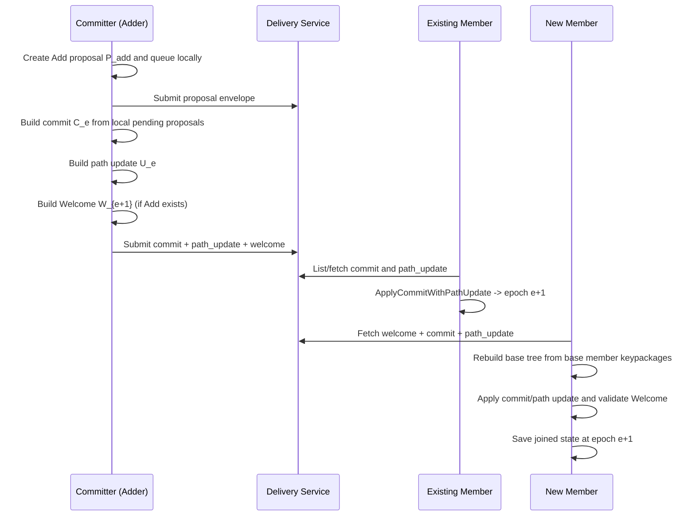

# Add Member (Simple View)

## Formal Setup
This action is the full add-member chain:
- proposer creates `Add` proposal,
- committer builds commit + path update,
- committer emits Welcome,
- existing members sync/apply,
- new member joins via Welcome.

Let:
- $g$ be group id.
- $e$ be current epoch before add.
- $KP_{new}$ be the new member key package.
- $s$ be committer sender leaf.
- $P_{add}=\mathrm{Add}(KP_{new})$.
- $C_e$ be commit at epoch $e$.
- $U_e$ be the path-update payload paired with $C_e$.
- $W_{e+1}$ be Welcome for post-commit epoch $e+1$.
- $S_e^i$ be local state of member $i$ at epoch $e$.

Plain-language meanings:
- Proposal says: "I want to add this new key package."
- Commit makes the add real and advances epoch.
- Path update rotates TreeKEM secrets.
- Welcome gives the new member the join secrets.

RFC 9420 Basis:
- Add/Commit proposal semantics, TreeKEM path update semantics, and Welcome-based joiner onboarding are RFC MLS core flow.
- This document follows project code behavior and flags non-RFC/convenience behavior explicitly.

Suspicious Findings:
- Commit is built from local `pending_proposals` queue, not from DS proposal list.
- Join bootstrap depends on provided base-member keypackage order.
- Optional legacy path-compat fallback can bypass strict lineage validation.
- Joiner Welcome validation currently accepts only `cipher_suite=0x0001`.

## Mathematical Flow
1. Create local Add proposal envelope
   Inputs: $S_e^{\mathrm{committer}}, KP_{new}, s$
   Outputs: proposal envelope $E_{prop}$ and updated local queue $Q_e$
   Equation:
   $$
   P_{add}=\mathrm{Add}(KP_{new})
   $$
   $$
   E_{prop}=(g,e,s,P_{add}),\quad Q_e \leftarrow Q_e \cup \{P_{add}\}
   $$
   Example: Alice loads Bob keypackage, creates add proposal file, and queues it locally.
   RFC 9420 Basis: Add proposal content and epoch-bound proposal envelope semantics.
   Suspicious Finding: proposal is queued locally first; DS is not source-of-truth for commit building.

2. Submit proposal to DS with signed request
   Inputs: $E_{prop}$, user signing key
   Outputs: DS stores proposal message
   Equation:
   $$
   \mathrm{sig\_input}_{prop}=\text{"proposal|"}\parallel u\parallel\text{"|"}\parallel g\parallel\text{"|"}\parallel H_{prop}(E_{prop})
   $$
   $$
   \mathrm{SubmitProposal}(g,E_{prop},\sigma(\mathrm{sig\_input}_{prop}))
   $$
   Example: proposal appears in DS as `kind=proposal`.
   RFC 9420 Basis: authenticated proposal transport (DS transport is implementation layer).
   Suspicious Finding: None.

3. Build commit from local pending proposals
   Inputs: $S_e^{\mathrm{committer}}, Q_e, s$
   Outputs: $C_e$
   Equation:
   $$
   C_e=\mathrm{BuildCommit}(Q_e,s),\quad \mathrm{ValidateCommit}(C_e)=1
   $$
   with checks such as duplicate add target rejection:
   $$
   \mathrm{DuplicateAddTarget}\Rightarrow\mathrm{error}
   $$
   Example: if two Add proposals target same identity/init key, commit is rejected.
   RFC 9420 Basis: commit proposal-set validation and sender-bound commit construction.
   Suspicious Finding: commit input set is local queue $Q_e$; DS proposal set is not read here.

4. Build TreeKEM path update for the same commit
   Inputs: tree after proposal preview, sender $s$, leaf secret $\ell$
   Outputs: $U_e=(\text{path\_secrets},\text{ciphertexts})$
   Equation:
   $$
   U_e=\mathrm{BuildPathUpdate}(s,\ell)
   $$
   $$
   C_e.\text{path}=\mathrm{ParentUpdatesFromSecretModel}(s,\ell)
   $$
   Example: committer produces parent public keys in commit and encrypted path secrets for receivers.
   RFC 9420 Basis: TreeKEM direct-path update and encrypted path secrets.
   Suspicious Finding: None.

5. Generate Welcome for added members
   Inputs: $C_e,U_e,S_e^{\mathrm{committer}}$
   Outputs: optional $W_{e+1}$
   Equation:
   $$
   \mathrm{Adds}(C_e)=\varnothing\Rightarrow W_{e+1}=\varnothing
   $$
   $$
   \mathrm{Adds}(C_e)\neq\varnothing\Rightarrow W_{e+1}=\mathrm{EncryptWelcome}(\mathrm{joiner\_secret}_{e+1},\mathrm{path\_secret},\mathrm{group\_info})
   $$
   Example: Add commit creates one encrypted group-secret entry per added keypackage.
   RFC 9420 Basis: Welcome carries encrypted group secrets and encrypted GroupInfo for joiners.
   Suspicious Finding: implementation uses `path_update.path_secrets.first()` as Welcome `path_secret` source.

6. Submit commit bundle (commit + optional path update + optional welcome)
   Inputs: $C_e,U_e,W_{e+1}$, signer
   Outputs: DS stores `commit`, `path_update`, `welcome` messages
   Equation:
   $$
   \mathrm{sig\_input}_{commit}=\text{"commit|"}\parallel u\parallel\text{"|"}\parallel g\parallel\text{"|"}\parallel H_{commit}(C_e)\parallel\text{"|"}\parallel H_{path}(U_e)\parallel\text{"|"}\parallel H(W_{e+1})
   $$
   $$
   \mathrm{SubmitCommit}(g,C_e,U_e,W_{e+1},\sigma(\mathrm{sig\_input}_{commit}))
   $$
   Example: DS enforces path-update metadata match when commit carries non-empty path.
   RFC 9420 Basis: authenticated commit transport; path update bound to same commit context.
   Suspicious Finding: DS checks decodability/metadata consistency, not full cryptographic semantic validity.

7. Existing members sync and apply commit+path update
   Inputs: local state $S_e^i$, fetched commit/path messages, receiver private key
   Outputs: $S_{e+1}^i$
   Equation:
   $$
   S_{e+1}^i=\mathrm{ApplyCommitWithPathUpdate}(S_e^i,C_e,U_e,sk_i)
   $$
   $$
   \neg\mathrm{MatchedPathUpdate}(C_e)\Rightarrow\mathrm{error}\;\text{(strict receiver policy)}
   $$
   Example: Bob syncs DS, finds matched path-update envelope, applies, and advances to epoch $e+1$.
   RFC 9420 Basis: receiver commit processing with TreeKEM decapsulation and epoch advance.
   Suspicious Finding: optional legacy-compat mode can apply when strict lineage validation fails.

8. New member joins with Welcome + commit + path update
   Inputs: base member keypackages, $C_e,U_e,W_{e+1}$, receiver private key
   Outputs: joined state $S_{e+1}^{new}$
   Equation:
   $$
   S_{base}=\mathrm{BootstrapFromBaseMembers}(g,e)
   $$
   $$
   S_{e+1}^{new}=\mathrm{ApplyCommitWithPathUpdate}(S_{base},C_e,U_e,sk_{new})
   $$
   $$
   \mathrm{ValidateWelcomeForJoiner}(W_{e+1},C_e,S_{e+1}^{new})=1
   $$
   Example: Bob decrypts matching `EncryptedGroupSecrets`, checks GroupInfo, then saves joined state.
   RFC 9420 Basis: Welcome joiner onboarding and GroupInfo consistency verification.
   Suspicious Finding: bootstrap correctness depends on base keypackage order; wrong order can break reconstruction.

9. Optional auto-bootstrap path during sync (unknown local group)
   Inputs: DS streams of commit/path/welcome
   Outputs: bootstrapped local state if a valid tuple is found
   Equation:
   $$
   (W_j,C_k,U_m)\;\text{valid tuple}\Rightarrow\mathrm{BootstrapAndJoin}
   $$
   Example: `fetch-and-apply-latest` can create missing local group state from DS Welcome tuple.
   RFC 9420 Basis: same Welcome+commit+path semantics, automated by implementation.
   Suspicious Finding: tuple selection is message-id based heuristic before cryptographic validation.

10. What to Watch (Presentation Callouts)
   Inputs: add-member walkthrough output
   Outputs: callout tuple $(\mathrm{checkpoints},\Delta\mathrm{state},\mathrm{suspicious\_summary})$
   Equation:
   $$
   \mathrm{Callout}_{add}=(\mathrm{proposal\_commit\_welcome\_chain},\mathrm{epoch\_advance},\mathrm{joiner\_onboard})
   $$
   | What to watch | Expected state delta | Suspicious summary |
   |---|---|---|
   | Add proposal is created, queued, and submitted | Pending proposals consumed into one commit | Commit builder uses local queue, not DS proposal stream |
   | Commit + path update are produced and accepted | Group epoch increases by `+1`; tree gains added member leaf | DS commit submit path does metadata/codec checks, semantic rejection can be delayed |
   | Welcome path succeeds for joiner | Joiner obtains valid state at new epoch and passes GroupInfo checks | Tuple pre-selection is ID-heuristic and welcome `path_secret` comes from first path-secret slot |
   RFC 9420 Basis: presentation checkpoints over Add proposal, commit apply, and Welcome onboarding.
   Suspicious Finding: None (summary step; suspicious items are listed in table).

## Protocol Visual (Mermaid)

## Implementation Traceability
| Symbol/Equation | File:Line | Function Name |
|---|---|---|
| `CreateAddProposal` command | `src/bin/ds_client.rs:185` | `Commands::CreateAddProposal` |
| $E_{prop}=(g,e,s,P_{add})$ creation + local queue write | `src/bin/ds_client.rs:968` | `main` (CreateAddProposal arm) |
| $Q_e \leftarrow Q_e \cup \{P\}$ | `src/client_state.rs:80` | `ClientGroupState::queue_proposal` |
| proposal submit request | `src/bin/ds_client.rs:674` | `main` (SubmitProposal arm) |
| $\mathrm{sig\_input}_{prop}$ | `src/bin/ds_client.rs:3127` | `proposal_signing_input` |
| $C_e=\mathrm{BuildCommit}(Q_e,s)$ | `src/bin/ds_client.rs:2199` | `build_commit_from_pending` |
| $\mathrm{ValidateCommit}(C_e)$ | `src/tree.rs:1092` | `RatchetTree::validate_commit` |
| preview apply proposals before path build | `src/bin/ds_client.rs:2362` | `apply_proposals_preview` |
| $U_e=\mathrm{BuildPathUpdate}(s,\ell)$ | `src/tree.rs:983` | `RatchetTree::build_path_update` |
| create commit + path + welcome files | `src/bin/ds_client.rs:1067` | `main` (CreateCommit arm) |
| Welcome generation | `src/bin/ds_client.rs:2256` | `build_welcome_for_commit` |
| $\mathrm{sig\_input}_{commit}$ | `src/bin/ds_client.rs:3139` | `commit_signing_input` |
| commit submit request | `src/bin/ds_client.rs:700` | `main` (SubmitCommit arm) |
| DS commit/path/welcome submission checks | `src/ds/http.rs:1379` | `parse_and_validate_commit_submission_payload` |
| DS stores commit/path_update/welcome | `src/ds/http.rs:927` | `submit_commit` |
| receiver strict path matching and apply | `src/bin/ds_client.rs:2725` | `fetch_and_apply_latest_once` |
| strict receiver rejection on missing/mismatch path | `src/bin/ds_client.rs:2798` | `fetch_and_apply_latest_once` |
| join via Welcome command | `src/bin/ds_client.rs:1294` | `Commands::JoinFromWelcome` |
| join state reconstruction from commit/path | `src/bin/ds_client.rs:1728` | `join_from_commit_material` |
| Welcome decrypt + GroupInfo consistency checks | `src/bin/ds_client.rs:1817` | `validate_welcome_for_joiner` |
| unknown-group auto-bootstrap via welcome tuple | `src/bin/ds_client.rs:2847` | `try_bootstrap_unknown_group_from_welcome_once` |
| `SUSPICIOUS: commit uses local pending queue, not DS proposal list` | `src/client_state.rs:80` | `ClientGroupState::queue_proposal` |
| `SUSPICIOUS: local queue is commit input source` | `src/bin/ds_client.rs:2199` | `build_commit_from_pending` |
| `SUSPICIOUS: Welcome path_secret takes first path secret` | `src/bin/ds_client.rs:2333` | `build_welcome_for_commit` |
| `SUSPICIOUS: cipher suite hard-coded to 0x0001 in join validation` | `src/bin/ds_client.rs:1824` | `validate_welcome_for_joiner` |
| `SUSPICIOUS: legacy path compat fallback can bypass strict lineage` | `src/bin/ds_client.rs:2767` | `fetch_and_apply_latest_once` |
| `SUSPICIOUS: base keypackage ordering affects join reconstruction` | `src/bin/ds_client.rs:1746` | `join_from_commit_material` |
