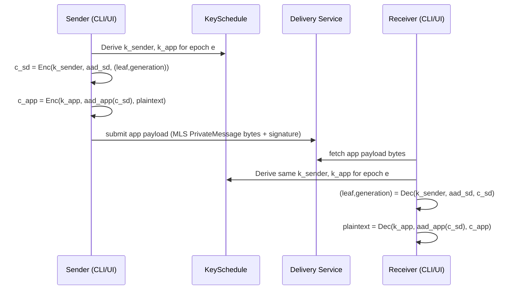

# Application Message Protection Flow (Simple View)

## Formal Setup
This page explains how application messages are protected and opened in the current implementation.

Let:
- $S_e=(g,e,T_e,\mathrm{KS}_e)$ be local state at epoch $e$.
- $\mathrm{DS}_e=(k_{\mathrm{sender}},k_{\mathrm{app}})$ be derived sender-data and application secrets for epoch $e$.
- $m$ be plaintext application bytes.
- $\mathrm{ad}$ be authenticated-data bytes.
- $\mathrm{sd}=(\ell,\gamma)$ be sender data (sender leaf index $\ell$, generation $\gamma$).
- $\mathrm{Enc}(k,\mathrm{aad},x)$ and $\mathrm{Dec}(k,\mathrm{aad},c)$ be AEAD encrypt/decrypt.
- $\mathcal{P}$ be `PrivateMessage`.

RFC 9420 Basis:
- Uses `PrivateMessage` wire framing with encrypted sender data and encrypted application content.
- Sender-data and application protection are bound to group/epoch/content type and authenticated data.

Suspicious Findings:
- Sender generation is fixed at $\gamma=0$ in current code (no per-sender ratchet progression yet).
- Nonce derivation is deterministic from key + AAD; with fixed sender generation and empty AAD, repeated sends in one epoch can reuse key/nonce.
- CLI allows raw plaintext app publish when `--group-state` is omitted.
- DS app endpoint stores opaque bytes after request-signature verification and does not enforce RFC-style `PrivateMessage` structure.

## Mathematical Flow
1. Derive epoch application secrets
   Inputs: $S_e=(g,e,\mathrm{KS}_e)$
   Outputs: $\mathrm{DS}_e=(k_{\mathrm{sender}},k_{\mathrm{app}})$
   Equation:
   $$
   \mathrm{DS}_e=\mathrm{DeriveSecretsForEpoch}(\mathrm{KS}_e,g,e)
   $$
   with:
   $$
   k_{\mathrm{sender}}=\mathrm{StageKey}(\text{"sender\_data"},\mathrm{epoch\_secret}_e,\mathrm{gch}_e),\quad
   k_{\mathrm{app}}=\mathrm{HashLabel}(\text{"application\_secret"},\mathrm{gch}_e,[\mathrm{epoch\_secret}_e,g,e])
   $$
   Example: sender and receiver in the same epoch derive the same keys.
   RFC 9420 Basis: per-epoch key schedule fanout for sender-data and application protection.
   Suspicious Finding: None.

2. Build sender-data and sender-data AAD
   Inputs: $\ell,\gamma,g,e,\mathrm{ad}$
   Outputs: $\mathrm{sd},\mathrm{aad}_{\mathrm{sd}}$
   Equation:
   $$
   \mathrm{sd}=(\ell,\gamma),\quad \gamma=0\ \text{(current implementation)}
   $$
   $$
   \mathrm{aad}_{\mathrm{sd}}=\mathrm{Encode}(\text{"MLS-PRIVATE-SENDER-DATA-AAD"},g,e,\text{Application},\mathrm{ad})
   $$
   Example: sender leaf index is hidden inside encrypted sender-data bytes.
   RFC 9420 Basis: sender-data protection with PrivateMessage-bound AAD.
   Suspicious Finding: generation is currently constant $\gamma=0$ (no per-sender message-key progression).

3. Encrypt sender-data
   Inputs: $k_{\mathrm{sender}},\mathrm{aad}_{\mathrm{sd}},\mathrm{sd}$
   Outputs: $c_{\mathrm{sd}}$
   Equation:
   $$
   c_{\mathrm{sd}}=\mathrm{Enc}(k_{\mathrm{sender}},\mathrm{aad}_{\mathrm{sd}},\mathrm{sd})
   $$
   Example: receiver must decrypt this first to recover sender leaf.
   RFC 9420 Basis: `encrypted_sender_data` field in `PrivateMessage`.
   Suspicious Finding: deterministic AEAD nonce derivation plus fixed sender-data inputs can repeat $c_{\mathrm{sd}}$ in the same epoch.

4. Encrypt application plaintext
   Inputs: $k_{\mathrm{app}},g,e,\mathrm{ad},c_{\mathrm{sd}},m$
   Outputs: $c_{\mathrm{app}}$
   Equation:
   $$
   \mathrm{aad}_{\mathrm{app}}=\mathrm{Encode}(\text{"MLS-PRIVATE-CIPHERTEXT-AAD"},g,e,\text{Application},\mathrm{ad},c_{\mathrm{sd}})
   $$
   $$
   c_{\mathrm{app}}=\mathrm{Enc}(k_{\mathrm{app}},\mathrm{aad}_{\mathrm{app}},m)
   $$
   Example: ciphertext is bound to the encrypted sender-data field.
   RFC 9420 Basis: application ciphertext protection inside `PrivateMessage`.
   Suspicious Finding: with deterministic nonce derivation and fixed AAD inputs, repeated sends may reuse key/nonce in one epoch.

5. Build MLS `PrivateMessage` wire object
   Inputs: $g,e,\mathrm{ad},c_{\mathrm{sd}},c_{\mathrm{app}}$
   Outputs: $\mathcal{P}$
   Equation:
   $$
   \mathcal{P}=(g,e,\text{Application},\mathrm{ad},c_{\mathrm{sd}},c_{\mathrm{app}})
   $$
   then:
   $$
   \mathrm{wire}=\mathrm{MLSMessage}(\text{PrivateMessage},\mathcal{P})
   $$
   Example: on-wire bytes are not plaintext when protected flow is used.
   RFC 9420 Basis: `MLSMessage` with `WireFormat::PrivateMessage`.
   Suspicious Finding: CLI has optional plaintext publish path if local group-state protection is skipped.

6. Signed DS transport for application payload bytes
   Inputs: $\mathrm{wire}$, username, session, group id
   Outputs: stored DS message id
   Equation:
   $$
   \sigma=\mathrm{Sign}(\text{"app\_publish"}\parallel \mathrm{username}\parallel g\parallel H(\mathrm{wire}))
   $$
   $$
   \mathrm{DS.store}(g,\text{application},\mathrm{wire},\sigma)\rightarrow \mathrm{message\_id}
   $$
   Example: DS authenticates the sender request and stores payload under kind `application`.
   RFC 9420 Basis: transport-level authentication is implementation-specific; payload format remains MLS private-message style.
   Suspicious Finding: DS does not parse/validate that payload is RFC-style `PrivateMessage` before storing.

7. Fetch and decrypt on receiver
   Inputs: stored payload bytes, local $S_e$
   Outputs: $(\ell,\gamma,\mathrm{ad},m)$ or rejection
   Equation:
   $$
   \mathcal{P}=\mathrm{DecodePrivateMessage}(\mathrm{wire})
   $$
   reject if $(\mathcal{P}.g\neq g)\lor(\mathcal{P}.e\neq e)\lor(\mathcal{P}.\mathrm{type}\neq\text{Application})$.
   $$
   (\ell,\gamma)=\mathrm{Dec}(k_{\mathrm{sender}},\mathrm{aad}_{\mathrm{sd}},c_{\mathrm{sd}})
   $$
   $$
   m=\mathrm{Dec}(k_{\mathrm{app}},\mathrm{aad}_{\mathrm{app}},c_{\mathrm{app}})
   $$
   Example: wrong epoch/group or tampered ciphertext fails to open.
   RFC 9420 Basis: PrivateMessage open path with sender-data + ciphertext decryption checks.
   Suspicious Finding: decoded sender leaf $\ell$ is not explicitly bounds-checked against current tree size in unprotect path.

8. What to Watch (Presentation Callouts)
   Inputs: application-protection walkthrough output
   Outputs: callout tuple $(\mathrm{checkpoints},\Delta\mathrm{state},\mathrm{suspicious\_summary})$
   Equation:
   $$
   \mathrm{Callout}_{app}=(\mathrm{private\_wire\_clear},\mathrm{decrypt\_gate\_clear},\mathrm{risk\_scope\_clear})
   $$
   | What to watch | Expected state delta | Suspicious summary |
   |---|---|---|
   | Show that sent payload decodes to MLS `PrivateMessage`, not plaintext | DS stores application payload bytes; fetch returns same bytes | CLI can still send raw plaintext if `--group-state` is omitted |
   | Show open fails on wrong epoch/tamper | Receiver returns decrypt failure and no plaintext | sender leaf from decrypted sender-data is not bounds-checked in unprotect path |
   | Explain nonce/generation caveat clearly | No immediate UI state change, but crypto risk understanding increases | deterministic nonce + fixed generation + empty AAD can cause nonce reuse in same epoch |
   RFC 9420 Basis: presentation checks for private-message protection and open semantics.
   Suspicious Finding: None (summary step; suspicious items are listed in table).

## Protocol Visual (Mermaid)

## Implementation Traceability
| Symbol/Equation | File:Line | Function Name |
|---|---|---|
| $k_{\mathrm{sender}},k_{\mathrm{app}}=\mathrm{DeriveSecretsForEpoch}(\cdot)$ | `src/key_schedule.rs:105` | `KeyScheduleState::derive_secrets_for_epoch` |
| stage-key derivation for sender-data (`sender_data`) | `src/stage_keys.rs:20` | `derive_epoch_stage_keys_with_context` |
| application secret derivation | `src/key_schedule.rs:382` | `derive_epoch_secrets` |
| $\mathrm{sd}=(\ell,\gamma)$ encode/decode | `src/application_message.rs:125` | `encode_sender_data` / `decode_sender_data` |
| $\mathrm{aad}_{\mathrm{sd}}$ construction | `src/application_message.rs:146` | `sender_data_aad` |
| $c_{\mathrm{sd}}=\mathrm{Enc}(k_{\mathrm{sender}},\mathrm{aad}_{\mathrm{sd}},\mathrm{sd})$ | `src/application_message.rs:33` | `protect_application_message` |
| $\mathrm{aad}_{\mathrm{app}}$ construction | `src/application_message.rs:162` | `ciphertext_aad` |
| $c_{\mathrm{app}}=\mathrm{Enc}(k_{\mathrm{app}},\mathrm{aad}_{\mathrm{app}},m)$ | `src/application_message.rs:43` | `protect_application_message` |
| `PrivateMessage` wire fields | `src/mls_wire.rs:60` | `PrivateMessage` |
| `MLSMessage` private wire encode/decode | `src/mls_wire.rs:89` | `MlsMessage::from_private` / `MlsMessage::decode` |
| sender-side protect wrapper to bytes | `src/application_message.rs:55` | `protect_application_message_bytes` |
| receiver open/decrypt path | `src/application_message.rs:65` | `unprotect_application_message` |
| CLI send app message (protected path) | `src/bin/ds_client.rs:782` | `main` (`SendAppMessage`) |
| CLI fetch app message (optional local unprotect) | `src/bin/ds_client.rs:852` | `main` (`FetchAppMessage`) |
| DS app submit endpoint | `src/ds/http.rs:1029` | `submit_app_message` |
| DS app list endpoint | `src/ds/http.rs:1067` | `list_app_messages` |
| DS app fetch endpoint | `src/ds/http.rs:1116` | `fetch_app_message` |
| DS app publish signing input | `src/ds/http.rs:1807` | `app_publish_signing_input` |
| UI app send endpoint | `src/bin/ds_ui_gateway.rs:3191` | `api_send_app_message` |
| UI app fetch + decrypt mapping | `src/bin/ds_ui_gateway.rs:5199` | `ds_fetch_app_message` |
| DS-backed e2e private-message roundtrip | `tests/ds_fetch_apply_e2e.rs:10337` | `app_private_message_ds_roundtrip_with_group_state` |
| `SUSPICIOUS: sender generation is fixed to 0` | `src/application_message.rs:26` | `protect_application_message` |
| `SUSPICIOUS: deterministic nonce derivation from key + AAD` | `src/crypto.rs:147` | `derive_aead_key_nonce` |
| `SUSPICIOUS: CLI uses empty authenticated_data in protected send path` | `src/bin/ds_client.rs:797` | `main` (`SendAppMessage`) |
| `SUSPICIOUS: UI also uses empty authenticated_data in send path` | `src/bin/ds_ui_gateway.rs:5281` | `ds_send_app_message` |
| `SUSPICIOUS: CLI permits plaintext publish if --group-state is omitted` | `src/bin/ds_client.rs:799` | `main` (`SendAppMessage`) |
| `SUSPICIOUS: DS stores app payload bytes without PrivateMessage semantic validation` | `src/ds/http.rs:1052` | `submit_app_message` |
| `SUSPICIOUS: unprotect returns sender_leaf without explicit leaf-bound check` | `src/application_message.rs:90` | `unprotect_application_message` |
