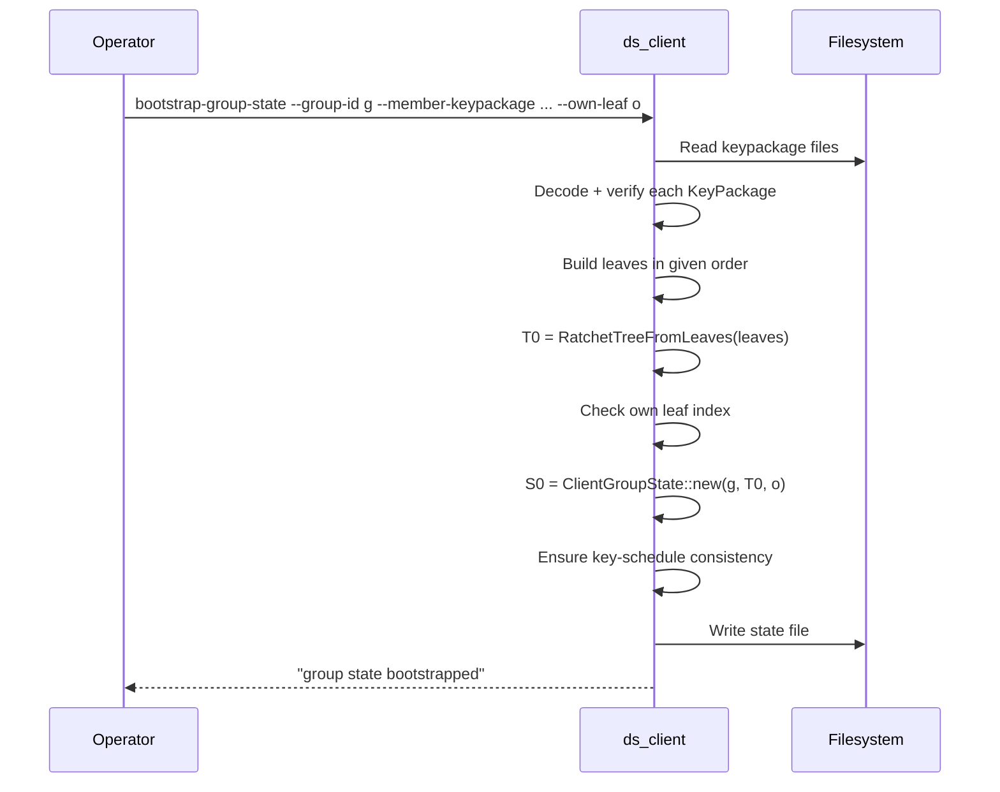

# Create Group (Simple View)

## Formal Setup
This action is the CLI command:
`ds_client bootstrap-group-state`

Let:
- $g$ be `--group-id`.
- $K=(K_0,\dots,K_{n-1})$ be the ordered keypackage files from `--member-keypackage`.
- $o$ be `--own-leaf`.
- $KP_i$ be the decoded key package from file $K_i$.
- $L_i=(KP_i.\text{init\_key}, KP_i.\text{identity})$ be leaf $i$.
- $T_0=\mathrm{RatchetTreeFromLeaves}(L_0,\dots,L_{n-1})$.
- $S_0=\mathrm{ClientGroupState::new}(g,T_0,o)$.

Plain-language meanings:
- `create-group` here means "create first local MLS state file", not "send a network commit".
- Each `member-keypackage` becomes one member leaf in the local tree.

RFC 9420 Basis:
- Uses RFC-style primitives (KeyPackage, leaf nodes, ratchet tree, epoch-0 state).
- This specific command is a local bootstrap convenience, not a full RFC wire handshake.

Suspicious Findings:
- Leaf positions depend on CLI input order.
- No explicit duplicate-member check in this bootstrap path.
- No explicit non-empty `group_id` check in this bootstrap path.
- Produces local state only (no Commit/Welcome exchange yet).

## Mathematical Flow
1. Basic safety checks
   Inputs: `out`, `force`, $K$
   Outputs: continue/error
   Equation:
   $$
   \mathrm{exists}(out)\land \neg force \Rightarrow \mathrm{error}
   $$
   $$
   |K|=0 \Rightarrow \mathrm{error}
   $$
   Example: if state file already exists and you did not pass `--force`, command stops.
   RFC 9420 Basis: No direct RFC step; local CLI safety.
   Suspicious Finding: None.

2. Load and verify each member key package
   Inputs: $K$
   Outputs: verified $(KP_0,\dots,KP_{n-1})$
   Equation:
   $$
   KP_i=\mathrm{DecodeVerifyKP}(K_i),\quad \forall i
   $$
   $$
   \mathrm{Verify}(KP_i)=1
   $$
   Example: one broken keypackage file stops the whole create-group.
   RFC 9420 Basis: KeyPackage verification primitive.
   Suspicious Finding: duplicate identity/init-key pairs are not explicitly rejected here.

3. Convert packages to leaves and build tree
   Inputs: $(KP_0,\dots,KP_{n-1})$
   Outputs: $T_0$
   Equation:
   $$
   L_i=(KP_i.\text{init\_key},KP_i.\text{identity})
   $$
   $$
   T_0=\mathrm{RatchetTreeFromLeaves}(L_0,\dots,L_{n-1})
   $$
   Example: input order `[Alice, Bob, Carol]` becomes leaf order `0,1,2` respectively.
   RFC 9420 Basis: Ratchet tree leaf construction.
   Suspicious Finding: changing CLI order changes leaf indices.

4. Check your own leaf index
   Inputs: $T_0,o$
   Outputs: continue/error
   Equation:
   $$
   0\le o<\mathrm{leaf\_count}(T_0)\land T_0[\mathrm{leaf\_to\_node}(o)]=\mathrm{Leaf}
   $$
   Example: if `--own-leaf 3` but tree has only 3 leaves (`0,1,2`), command fails.
   RFC 9420 Basis: No direct RFC step; local consistency.
   Suspicious Finding: None.

5. Create initial state (epoch 0)
   Inputs: $g,T_0,o$
   Outputs: $S_0$
   Equation:
   $$
   S_0=\mathrm{ClientGroupState::new}(g,T_0,o),\quad \mathrm{epoch}(S_0)=0
   $$
   with initial seed material derived from tree snapshot:
   $$
   \text{tree\_hash}_0=\text{SHA3-256}(\mathrm{encode}(T_0))
   $$
   $$
   \text{init\_secret}=\mathrm{labeled\_hash}(\text{"init\_secret"},g,[g,\text{tree\_hash}_0])
   $$
   Example: after this step you have a local `.bin` state file ready for next actions.
   RFC 9420 Basis: epoch-0 state/key-schedule initialization primitives.
   Suspicious Finding: no network commit/welcome is sent in this action.

6. Save state with consistency check
   Inputs: $S_0,\text{out}$
   Outputs: persisted state file
   Equation:
   $$
   \mathrm{EnsureKeyScheduleConsistency}(S_0)=\mathrm{true}
   $$
   $$
   \mathrm{SaveToFile}(S_0,\text{out})
   $$
   Example: inconsistent state is rejected before write.
   RFC 9420 Basis: No direct RFC step; implementation integrity guard.
   Suspicious Finding: None.

7. What to Watch (Presentation Callouts)
   Inputs: create-group execution result
   Outputs: callout tuple $(\mathrm{checkpoints},\Delta\mathrm{state},\mathrm{suspicious\_summary})$
   Equation:
   $$
   \mathrm{Callout}_{create}=(\mathrm{all\_kp\_verified},\mathrm{own\_leaf\_valid},\mathrm{state\_saved})
   $$
   | What to watch | Expected state delta | Suspicious summary |
   |---|---|---|
   | All member keypackages decode+verify | Tree can be built from trusted leaves only | Duplicate identity/init-key checks are not explicit in this path |
   | Own leaf index check passes | `own_leaf_index` points to a real non-blank leaf | Leaf index assignment depends on CLI member order |
   | State save succeeds with consistency check | New local state at epoch `0`, empty pending queue, initialized key schedule/transcript | No wire commit/welcome occurs in this action |
   RFC 9420 Basis: presentation checkpoints over bootstrap-state correctness before first commit.
   Suspicious Finding: None (summary step; suspicious items are listed in table).

## Protocol Visual (Mermaid)

## Implementation Traceability
| Symbol/Equation | File:Line | Function Name |
|---|---|---|
| CLI command inputs | `src/bin/ds_client.rs:75` | `Commands::BootstrapGroupState` |
| output overwrite + non-empty member checks | `src/bin/ds_client.rs:529` | `main` (BootstrapGroupState arm) |
| $KP_i=\mathrm{DecodeVerifyKP}(K_i)$ | `src/bin/ds_client.rs:1672` | `load_keypackage_from_file` |
| $\mathrm{Verify}(KP_i)$ | `src/bin/ds_client.rs:1677` | `load_keypackage_from_file` |
| $L_i=(KP_i.\text{init\_key},KP_i.\text{identity})$ | `src/bin/ds_client.rs:1684` | `leaf_from_keypackage` |
| ordered leaf loop | `src/bin/ds_client.rs:540` | `main` (BootstrapGroupState arm) |
| $T_0=\mathrm{RatchetTreeFromLeaves}(\cdot)$ | `src/bin/ds_client.rs:546` | `RatchetTree::from_leaves` |
| own leaf check | `src/bin/ds_client.rs:1658` | `ensure_leaf_present` |
| $S_0=\mathrm{ClientGroupState::new}(g,T_0,o)$ | `src/bin/ds_client.rs:549` | `ClientGroupState::new` |
| tree hash seed | `src/client_state.rs:50` | `ClientGroupState::new` |
| $\text{tree\_hash}_0=\text{SHA3-256}(\mathrm{encode}(T_0))$ | `src/client_state.rs:528` | `current_tree_hash` |
| $\text{init\_secret}$ derivation root | `src/key_schedule.rs:65` | `KeyScheduleState::new` |
| consistency gate before save | `src/bin/ds_client.rs:1625` | `save_group_state` |
| `SUSPICIOUS: leaf indices depend on CLI order` | `src/bin/ds_client.rs:540` | `main` (BootstrapGroupState arm) |
| `SUSPICIOUS: duplicate-member checks not explicit in bootstrap path` | `src/bin/ds_client.rs:540` | `main` (BootstrapGroupState arm) |
| `SUSPICIOUS: explicit non-empty group_id guard not present here` | `src/bin/ds_client.rs:522` | `main` (BootstrapGroupState arm) |
| `SUSPICIOUS: local-only init, no Commit/Welcome exchange` | `src/bin/ds_client.rs:549` | `main` (BootstrapGroupState arm) |
