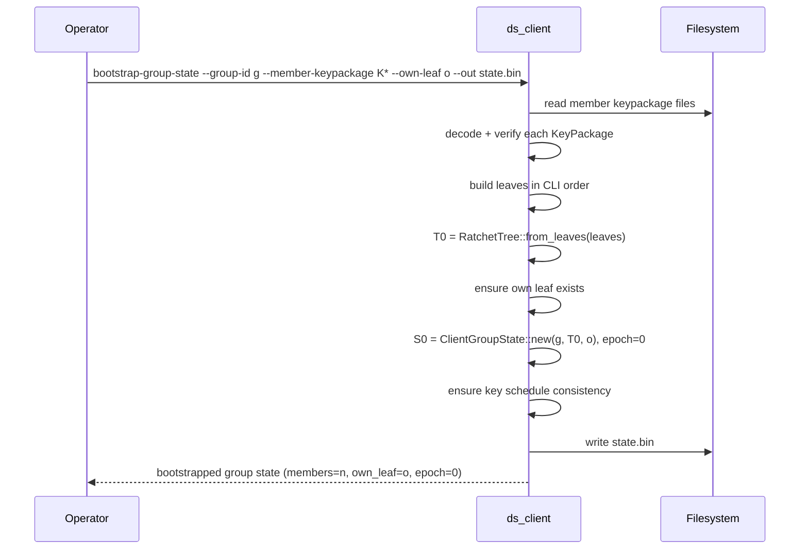

# Create Group (`ds_client bootstrap-group-state`)

## Formal Setup
Let:
- $g$ be the CLI `--group-id`.
- $K = (K_0,\dots,K_{n-1})$ be the ordered list of `--member-keypackage` files (order is user-provided).
- $\mathsf{DecodeVerifyKP}(K_i)$ decode and verify the key package signature.
- $\mathsf{Leaf}(KP_i)=(\text{init\_key}_i,\text{identity}_i)$.
- $L=(L_0,\dots,L_{n-1})$ be leaf nodes where $L_i=\mathsf{Leaf}(KP_i)$.
- $o$ be `--own-leaf`.
- $T_0=\mathsf{RatchetTreeFromLeaves}(L)$.
- $S_0=\mathsf{ClientGroupState::new}(g,T_0,o)$.

RFC 9420 Basis:
- This command initializes local MLS state using RFC-aligned primitives (KeyPackage, LeafNode, RatchetTree, epoch/key-schedule init).
- It is a local bootstrap utility, not a direct RFC wire exchange (no proposal/commit/welcome messages sent here).

Suspicious Findings:
- Member ordering is entirely CLI-order driven; leaf indices depend on argument order.
- No explicit duplicate-member/duplicate-identity validation in bootstrap path.
- No explicit `group_id` non-empty validation in this command path.
- Creates local baseline state only; no Commit/Welcome synchronization is performed here.

## Mathematical Flow
1. Validate bootstrap preconditions
   Inputs: `out`, `force`, `member_keypackage`
   Outputs: pass/fail
   Equation:
   $$
   \text{if }(\mathrm{exists}(out)\land \neg force)\Rightarrow \mathrm{error}
   $$
   $$
   \text{if }|K|=0\Rightarrow \mathrm{error}
   $$
   Human meaning: refuse accidental overwrite and empty-member bootstrap.
   RFC 9420 Basis: No direct RFC step; local safety checks.
   Suspicious Finding: None.

2. Load and verify each member KeyPackage
   Inputs: $K$
   Outputs: verified key packages $(KP_0,\dots,KP_{n-1})$
   Equation:
   $$
   KP_i=\mathsf{DecodeVerifyKP}(K_i),\quad \forall i\in[0,n-1]
   $$
   with verification requirement:
   $$
   \mathsf{VerifySignature}(KP_i)=1
   $$
   Human meaning: bootstrap accepts only syntactically valid + signed key packages.
   RFC 9420 Basis: KeyPackage object and signature verification semantics (RFC-aligned primitive use).
   Suspicious Finding: No uniqueness checks across $\{KP_i\}$ are enforced here.

3. Build ordered leaf vector and ratchet tree
   Inputs: $(KP_0,\dots,KP_{n-1})$
   Outputs: $T_0$
   Equation:
   $$
   L_i=\mathsf{Leaf}(KP_i)=(\text{init\_key}_i,\text{identity}_i)
   $$
   $$
   T_0=\mathsf{RatchetTreeFromLeaves}(L_0,\dots,L_{n-1})
   $$
   Human meaning: every member key package becomes one leaf in the exact input order.
   RFC 9420 Basis: Ratchet-tree leaf modeling is RFC-aligned.
   Suspicious Finding: Leaf-index assignment is CLI-order dependent, so different operators can produce different local leaf indices for the same member set.

4. Validate own leaf index
   Inputs: $T_0, o$
   Outputs: pass/fail
   Equation:
   $$
   0 \le o < \mathrm{leaf\_count}(T_0)\ \land\ T_0[\mathrm{leaf\_to\_node}(o)] = \mathrm{Leaf}
   $$
   Human meaning: your local user must point to an existing non-blank leaf.
   RFC 9420 Basis: No direct RFC step; local state consistency check.
   Suspicious Finding: None.

5. Initialize group state and key schedule at epoch 0
   Inputs: $g, T_0, o$
   Outputs: $S_0$
   Equation:
   $$
   \text{tree\_hash}_0=\text{SHA3-256}(\mathrm{encode}(T_0))
   $$
   $$
   \text{init\_secret}=\mathrm{labeled\_hash}(\text{"init\_secret"}, g, [g,\text{tree\_hash}_0])
   $$
   $$
   S_0=\mathsf{ClientGroupState::new}(g,T_0,o),\quad \mathrm{epoch}(S_0)=0
   $$
   Human meaning: produce initial local MLS state with key schedule and transcript seeded from tree snapshot.
   RFC 9420 Basis: RFC-style group state seed primitives; local bootstrap wrapper.
   Suspicious Finding: Command does not perform protocol-level group creation exchange; state exists only locally until later DS message flow.

6. Persist state with consistency gate
   Inputs: $S_0$, `out`
   Outputs: saved state file
   Equation:
   $$
   \mathsf{EnsureKeyScheduleConsistency}(S_0)=\mathrm{true}
   $$
   $$
   \mathsf{SaveToFile}(S_0,out)
   $$
   Human meaning: refuse writing malformed/inconsistent state to disk.
   RFC 9420 Basis: No direct RFC step; implementation integrity guard.
   Suspicious Finding: None.

## Protocol Visual (Mermaid)

## Implementation Traceability
| Symbol/Equation | File:Line | Function Name |
|---|---|---|
| CLI inputs (`group_id`, `member_keypackage`, `own_leaf`, `out`) | `src/bin/ds_client.rs:75` | `Commands::BootstrapGroupState` |
| overwrite/empty checks | `src/bin/ds_client.rs:529` | `main` (BootstrapGroupState arm) |
| $KP_i=\mathsf{DecodeVerifyKP}(K_i)$ | `src/bin/ds_client.rs:1672` | `load_keypackage_from_file` |
| $\mathsf{VerifySignature}(KP_i)=1$ | `src/bin/ds_client.rs:1677` | `load_keypackage_from_file` |
| $L_i=\mathsf{Leaf}(KP_i)$ | `src/bin/ds_client.rs:1684` | `leaf_from_keypackage` |
| ordered leaf construction loop | `src/bin/ds_client.rs:540` | `main` (BootstrapGroupState arm) |
| $T_0=\mathsf{RatchetTreeFromLeaves}(L)$ | `src/bin/ds_client.rs:546` | `RatchetTree::from_leaves` |
| own leaf validation equation | `src/bin/ds_client.rs:1658` | `ensure_leaf_present` |
| $S_0=\mathsf{ClientGroupState::new}(g,T_0,o)$ | `src/bin/ds_client.rs:549` | `ClientGroupState::new` |
| key schedule seed from tree hash | `src/client_state.rs:50` | `ClientGroupState::new` |
| $\text{tree\_hash}_0=\text{SHA3-256}(\mathrm{encode}(T_0))$ | `src/client_state.rs:528` | `current_tree_hash` |
| $\text{init\_secret}$ derivation | `src/key_schedule.rs:65` | `KeyScheduleState::new` |
| consistency gate before save | `src/bin/ds_client.rs:1625` | `save_group_state` |
| `SUSPICIOUS: bootstrap leaf order depends on CLI argument order` | `src/bin/ds_client.rs:540` | `main` (BootstrapGroupState arm) |
| `SUSPICIOUS: no duplicate identity/init-key check in bootstrap path` | `src/bin/ds_client.rs:540` | `main` (BootstrapGroupState arm) |
| `SUSPICIOUS: no explicit non-empty group_id guard in bootstrap path` | `src/bin/ds_client.rs:522` | `main` (BootstrapGroupState arm) |
| `SUSPICIOUS: local-only initialization (no Commit/Welcome wire exchange)` | `src/bin/ds_client.rs:549` | `main` (BootstrapGroupState arm) |
