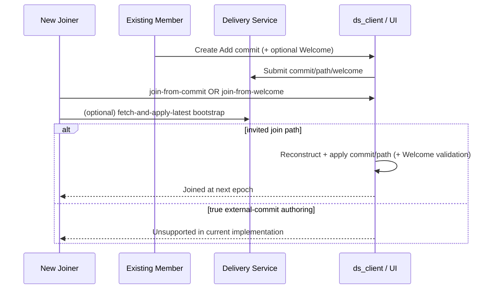

# External Join/Commit Semantics + Implementation Status (Simple View)

## Formal Setup
This page maps RFC 9420 external join/commit semantics to what your code currently supports.

Let:
- $\mathcal{R}_{ext}$ be RFC-style external join/commit semantics.
- $\mathcal{I}$ be current implementation behavior.
- $\mathrm{status}(x)\in\{\text{Supported},\text{Partial},\text{Unsupported}\}$ for each semantic item $x$.
- $J_c$ be `join-from-commit` flow.
- $J_w$ be `join-from-welcome` flow.
- $B_w$ be unknown-group bootstrap from DS welcome stream.

RFC 9420 Basis:
- External commit/join semantics are distinct from normal member commit flow.
- This doc separates true external semantics from current invited-join onboarding semantics.

Suspicious Findings:
- No dedicated external-commit authoring path exists in CLI/UI.
- No explicit `ExternalInit`-style proposal family exists in current proposal enum.
- `join-from-commit` enables join without Welcome validation (implementation convenience).
- Unknown-group bootstrap tuple selection is ID-heuristic before crypto validation.

## Mathematical Flow
1. Define status mapping goal
   Inputs: $\mathcal{R}_{ext},\mathcal{I}$
   Outputs: status map $M$
   Equation:
   $$
   M=\{(x,\mathrm{status}(x),\mathrm{evidence}(x))\mid x\in\mathcal{R}_{ext}\}
   $$
   Example: each external semantic item gets explicit Supported/Partial/Unsupported status.
   RFC 9420 Basis: implementation conformance mapping against protocol semantics.
   Suspicious Finding: None.

2. Distinguish invited join from true external commit
   Inputs: RFC external semantics, code flows $J_c,J_w,B_w$
   Outputs: classification boundary
   Equation:
   $$
   J_c,J_w,B_w\in\text{invited/add-based onboarding},\quad \neq \text{external-commit authoring}
   $$
   Example: your join flows consume commit/path/welcome produced by an existing member.
   RFC 9420 Basis: external commit is a separate semantic path from ordinary Add-based onboarding.
   Suspicious Finding: terminology can be confused in presentation unless this boundary is stated explicitly.

3. Supported item: invited join from existing commit/path material
   Inputs: base-member keypackages, commit/path, receiver private key
   Outputs: joined state at next epoch
   Equation:
   $$
   S_{e+1}=\mathrm{JoinFromCommitMaterial}(S_{base},C_e,U_e,sk)
   $$
   with optional Welcome validation in $J_w$:
   $$
   \mathrm{ValidateWelcomeForJoiner}(W_{e+1},C_e,S_{e+1})=1
   $$
   Example: `join-from-commit` and `join-from-welcome` are both implemented and tested.
   RFC 9420 Basis: joiner onboarding semantics are present (especially with Welcome path).
   Suspicious Finding: `join-from-commit` path can bypass Welcome checks entirely.

4. Partial item: DS-driven unknown-group onboarding
   Inputs: DS streams (`welcome`,`commit`,`path_update`), base-member keypackages, receiver private key
   Outputs: local state bootstrap
   Equation:
   $$
   (W_j,C_k,U_m)\xrightarrow{\text{select+validate}}S_{e+1}
   $$
   Example: `fetch-and-apply-latest` can bootstrap missing local group state from Welcome tuple.
   RFC 9420 Basis: same onboarding material is consumed, but orchestration is implementation-specific.
   Suspicious Finding: tuple pre-selection is message-id heuristic before full cryptographic checks.

5. Unsupported item: true external-commit authoring by non-member
   Inputs: outsider identity and group context
   Outputs: external commit payload
   Equation:
   $$
   \mathrm{CreateExternalCommit}(g,\text{outsider})=\bot\quad\text{(not implemented)}
   $$
   Example: no CLI/UI command exists to author an external commit artifact.
   RFC 9420 Basis: explicit gap versus external commit semantics.
   Suspicious Finding: unsupported path must be clearly stated in demo to avoid over-claiming RFC coverage.

6. Unsupported item: dedicated external-init proposal family
   Inputs: proposal type taxonomy
   Outputs: availability decision
   Equation:
   $$
   \mathrm{ExternalInit}\notin \mathrm{ProposalEnum}
   $$
   Example: proposal enum currently includes Add/Update/Remove/PSK/ReInit/GCE only.
   RFC 9420 Basis: external-join-specific proposal path not represented as a first-class proposal type here.
   Suspicious Finding: external-init-specific semantics are currently out of scope in code.

7. Security/control implications of current status
   Inputs: supported/unsupported map $M$
   Outputs: implementation-risk summary
   Equation:
   $$
   \mathrm{Risk}=\{\text{unsupported external commit path},\text{optional no-welcome join path},\text{bootstrap heuristic}\}
   $$
   Example: current model is strong for invited onboarding, but not complete for full external commit semantics.
   RFC 9420 Basis: conformance requires explicit handling of missing semantics.
   Suspicious Finding: claiming “full external commit support” would currently be incorrect.

8. External semantics status matrix
   Inputs: mapped items
   Outputs: presentation matrix
   Equation:
   $$
   M=\text{table of semantic item}\rightarrow\text{status}
   $$

   | Semantic Item | Status | Current Implementation Mapping |
   |---|---|---|
   | Invited join from commit/path material | Supported | `join-from-commit` |
   | Invited join with Welcome validation | Supported | `join-from-welcome` |
   | Unknown-group DS onboarding from Welcome stream | Partial | `fetch-and-apply-latest` bootstrap path |
   | External commit authoring by outsider | Unsupported | no CLI/UI/API authoring path |
   | External-init proposal family | Unsupported | no `Proposal` variant |
   | External-commit conformance test coverage | Unsupported | no explicit external-commit test cases found |

   Example: this matrix is your direct “what is done vs not done” answer for professor Q/A.
   RFC 9420 Basis: explicit status mapping for conformance scope.
   Suspicious Finding: None.

9. What to Watch (Presentation Callouts)
   Inputs: external semantics walkthrough output
   Outputs: callout tuple $(\mathrm{checkpoints},\Delta\mathrm{state},\mathrm{suspicious\_summary})$
   Equation:
   $$
   \mathrm{Callout}_{external}=(\mathrm{supported\_joins\_clear},\mathrm{unsupported\_external\_commit\_clear},\mathrm{scope\_boundary\_clear})
   $$
   | What to watch | Expected state delta | Suspicious summary |
   |---|---|---|
   | Show `join-from-commit` and `join-from-welcome` as implemented onboarding | Joiner can reach valid group state at next epoch | `join-from-commit` does not enforce Welcome checks |
   | Explicitly state external-commit authoring is not implemented | No state change (scope statement) | no external-commit command/proposal path |
   | Explain unknown-group bootstrap as implementation convenience | Unknown local state can be created from DS Welcome tuple | tuple pre-selection is heuristic before crypto validation |
   RFC 9420 Basis: presentation checkpoints for accurate implementation-scope communication.
   Suspicious Finding: None (summary step; suspicious items are listed in table).

## Protocol Visual (Mermaid)

## Implementation Traceability
| Symbol/Equation | File:Line | Function Name |
|---|---|---|
| join-from-commit command surface | `src/bin/ds_client.rs:243` | `Commands::JoinFromCommit` |
| join-from-welcome command surface | `src/bin/ds_client.rs:263` | `Commands::JoinFromWelcome` |
| join-from-commit handler | `src/bin/ds_client.rs:1244` | `main` (`JoinFromCommit`) |
| join-from-welcome handler | `src/bin/ds_client.rs:1294` | `main` (`JoinFromWelcome`) |
| shared join material apply path | `src/bin/ds_client.rs:1728` | `join_from_commit_material` |
| Welcome validation gate | `src/bin/ds_client.rs:1817` | `validate_welcome_for_joiner` |
| unknown-group bootstrap from DS welcome stream | `src/bin/ds_client.rs:2847` | `try_bootstrap_unknown_group_from_welcome_once` |
| proposal enum (no ExternalInit variant) | `src/tree.rs:59` | `Proposal` |
| current proposal families present | `src/tree.rs:68` | `Proposal::{PreSharedKey, ReInit, GroupContextExtensions}` |
| create proposal commands exposed to operators | `src/bin/ds_client.rs:185` | `Commands::CreateAddProposal` / `CreateUpdateProposal` / `CreateRemoveProposal` |
| join-from-commit DS-backed e2e usage | `tests/ds_fetch_apply_e2e.rs:3759` | `join-from-commit` scenario |
| unknown-group welcome bootstrap DS-backed test | `tests/ds_fetch_apply_e2e.rs:1944` | `fetch_and_apply_latest_bootstraps_unknown_group_from_welcome` |
| `SUSPICIOUS: no external-commit authoring command exists in CLI command enum` | `src/bin/ds_client.rs:75` | `Commands` enum |
| `SUSPICIOUS: no explicit ExternalInit-style proposal type in proposal enum` | `src/tree.rs:59` | `Proposal` |
| `SUSPICIOUS: join-from-commit path accepts join without Welcome validation` | `src/bin/ds_client.rs:1269` | `main` (`JoinFromCommit`) |
| `SUSPICIOUS: DS bootstrap tuple selection is message-id heuristic` | `src/bin/ds_client.rs:2927` | `try_bootstrap_unknown_group_from_welcome_once` |
