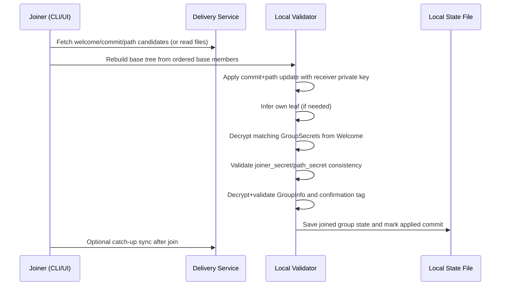

# Joiner Onboarding (Simple View)

## Formal Setup
This action explains two onboarding paths:
- CLI: `join-from-welcome` (and unknown-group bootstrap in `fetch-and-apply-latest`),
- UI: `join-from-latest` endpoint.

Let:
- $g$ be group id.
- $e$ be commit epoch before joiner enters.
- $W$ be Welcome message.
- $C_e$ be matching commit envelope.
- $U_e$ be matching path-update envelope.
- $B=(B_0,\dots,B_{n-1})$ be ordered base-member keypackages (pre-commit order).
- $sk_j$ be joiner receiver private key.
- $pk_j=\mathrm{PublicFromPrivate}(sk_j)$.
- $S_{e+1}^{j}$ be joined local state after applying onboarding material.

Plain-language meanings:
- Joiner onboarding requires a valid tuple: Welcome + Commit + PathUpdate.
- Base members define the pre-commit tree snapshot used for reconstruction.
- Join succeeds only if Welcome secrets and reconstructed local state are consistent.

RFC 9420 Basis:
- Joining via Welcome/GroupSecrets/GroupInfo plus commit/path state reconstruction follows MLS Welcome semantics.
- This document tracks current implementation behavior for CLI and UI onboarding.

Suspicious Findings:
- Base-member ordering is operator-provided and must match pre-commit leaf order.
- Tuple matching uses message-id heuristics before full cryptographic validation.
- Welcome validation currently requires `cipher_suite=0x0001`.
- Legacy path-compat fallback can bypass strict lineage binding during join material apply.

## Mathematical Flow
1. Collect onboarding material (CLI file inputs or DS lookup)
   Inputs: either local files $(W,C_e,U_e)$ or DS message streams
   Outputs: candidate tuple $(W,C_e,U_e)$
   Equation:
   $$
   \mathrm{Tuple}=(W,C_e,U_e)
   $$
   For DS lookup path (auto/UI):
   $$
   \text{pick }W_i\text{ (newest first)},\;\text{choose }C_k\text{ with }C_k.id<W_i.id,\;\text{choose }U_m\text{ matching }C_k
   $$
   Example: UI and unknown-group CLI both search `welcome`, `commit`, `path_update` streams and pair them.
   RFC 9420 Basis: join needs coherent Welcome + commit context.
   Suspicious Finding: tuple pre-selection is ID-heuristic; cryptographic checks happen later.

2. Rebuild base tree from ordered base members
   Inputs: ordered $B=(B_0,\dots,B_{n-1})$
   Outputs: pre-commit tree $T_e^{base}$ and initial local state shell
   Equation:
   $$
   T_e^{base}=\mathrm{RatchetTreeFromLeaves}(B_0,\dots,B_{n-1})
   $$
   $$
   S_e^{base}=\mathrm{ClientGroupState::new}(g,T_e^{base},0),\quad \mathrm{epoch}(S_e^{base})\leftarrow e
   $$
   Example: wrong base order can produce wrong inferred joiner leaf and failed validation.
   RFC 9420 Basis: joiner reconstructs pre-commit context to process commit/path.
   Suspicious Finding: correctness depends on operator-provided base-member order.

3. Infer joiner leaf and apply commit+path update
   Inputs: $S_e^{base}, C_e, U_e, sk_j$
   Outputs: provisional joined state and derived path secrets
   Equation:
   $$
   \hat{T}=\mathrm{ApplyCommitPreview}(T_e^{base},C_e)
   $$
   $$
   \mathrm{own\_leaf}=\mathrm{FindLeafByPublicKey}(\hat{T},pk_j)\;\text{(if not explicitly provided)}
   $$
   $$
   (S_{e+1}^{j},\mathrm{derived})=\mathrm{ApplyCommitWithPathUpdate}(S_e^{base},C_e,U_e,sk_j)
   $$
   Example: CLI can also take explicit `--own-leaf`; UI infers from receiver private key.
   RFC 9420 Basis: joiner consumes TreeKEM path update to derive shared epoch secrets.
   Suspicious Finding: if strict apply fails and compat is enabled, legacy fallback is used.

4. Validate Welcome decryptability for this joiner
   Inputs: $W, C_e, S_{e+1}^{j}, \mathrm{derived}, sk_j$
   Outputs: validated `GroupSecrets`
   Equation:
   $$
   \mathrm{refs}=\{\mathrm{KeyRef}(KP)\mid KP\in \mathrm{AddProposals}(C_e)\}
   $$
   $$
   \exists\,x\in W.\mathrm{secrets}:x.\mathrm{key\_ref}\in\mathrm{refs}\land \mathrm{Dec}(x,sk_j)=\mathrm{GroupSecrets}
   $$
   $$
   W.\mathrm{cipher\_suite}=0x0001
   $$
   Example: if no decryptable `EncryptedGroupSecrets` matches Add set + receiver key, join fails.
   RFC 9420 Basis: Welcome carries per-joiner encrypted GroupSecrets bound to Add targets.
   Suspicious Finding: implementation currently hard-codes single cipher suite acceptance.

5. Cross-check GroupSecrets against local derived state
   Inputs: decrypted `GroupSecrets`, local key-schedule/view
   Outputs: accept/reject
   Equation:
   $$
   \mathrm{GroupSecrets.path\_secret}\neq\varnothing\Rightarrow \mathrm{GroupSecrets.path\_secret}=\mathrm{derived}[0]
   $$
   $$
   \mathrm{GroupSecrets.joiner\_secret}=\mathrm{LocalChain.joiner\_secret}
   $$
   Example: mismatch means tuple is inconsistent or tampered.
   RFC 9420 Basis: joiner secret and path secret must align with commit/path processing.
   Suspicious Finding: None.

6. Decrypt and validate GroupInfo
   Inputs: `welcome_secret`, encrypted GroupInfo, local reconstructed state
   Outputs: accept/reject GroupInfo
   Equation:
   $$
   GI=\mathrm{Dec}(W.\mathrm{encrypted\_group\_info},\mathrm{welcome\_secret},\mathrm{ctx}(g,e+1,s))
   $$
   $$
   GI.g=g\land GI.epoch=e+1\land GI.signer=s
   $$
   $$
   GI.\mathrm{tree\_hash}=H(T_{e+1}^{local}),\;GI.\mathrm{confirmed\_transcript\_hash}=\mathrm{local\_confirmed\_th}
   $$
   $$
   \mathrm{VerifyConfirmationTag}(GI)=1
   $$
   Example: any mismatch (group, epoch, signer, tree hash, confirmation tag, extensions) aborts onboarding.
   RFC 9420 Basis: GroupInfo authenticity/consistency checks for Welcome onboarding.
   Suspicious Finding: None.

7. Persist joined state and mark replay progress
   Inputs: validated joined state and matched commit id
   Outputs: saved local group state
   Equation:
   $$
   \mathrm{mark\_applied\_commit\_id}(C_e.id),\quad \mathrm{save}(S_{e+1}^{j})
   $$
   Optional catch-up:
   $$
   S_{final}=\mathrm{FetchAndApplyLatest}(S_{e+1}^{j})
   $$
   Example: UI `join-from-latest` performs immediate catch-up sync after join.
   RFC 9420 Basis: post-join epoch continuity and anti-replay state progression.
   Suspicious Finding: None.

8. What to Watch (Presentation Callouts)
   Inputs: joiner-onboarding walkthrough output
   Outputs: callout tuple $(\mathrm{checkpoints},\Delta\mathrm{state},\mathrm{suspicious\_summary})$
   Equation:
   $$
   \mathrm{Callout}_{join}=(\mathrm{tuple\_validated},\mathrm{welcome\_validated},\mathrm{state\_persisted})
   $$
   | What to watch | Expected state delta | Suspicious summary |
   |---|---|---|
   | Commit/path/welcome tuple is selected and validated | Joiner can reconstruct and apply into epoch `e+1` | Pre-selection is ID-heuristic before cryptographic checks |
   | Welcome GroupSecrets + GroupInfo checks pass | Joiner secret, transcript hash, confirmation tag, tree hash all align | Base-member order must match committer view |
   | Joined state is saved and replay marker set | Local group state becomes active and catch-up sync can continue | Single-cipher-suite acceptance and optional legacy-compat fallback |
   RFC 9420 Basis: presentation checkpoints over Welcome-based onboarding safety gates.
   Suspicious Finding: None (summary step; suspicious items are listed in table).

## Protocol Visual (Mermaid)

## Implementation Traceability
| Symbol/Equation | File:Line | Function Name |
|---|---|---|
| CLI join command | `src/bin/ds_client.rs:1294` | `Commands::JoinFromWelcome` |
| load and decode Welcome file | `src/bin/ds_client.rs:1723` | `load_welcome_from_file` |
| unknown-group bootstrap argument guards | `src/bin/ds_client.rs:1404` | `main` (FetchAndApplyLatest arm) |
| unknown-group bootstrap entry | `src/bin/ds_client.rs:1436` | `try_bootstrap_unknown_group_from_welcome_once` (call site) |
| DS tuple search (`welcome`,`commit`,`path_update`) | `src/bin/ds_client.rs:2847` | `try_bootstrap_unknown_group_from_welcome_once` |
| commit<welcome id heuristic | `src/bin/ds_client.rs:2927` | `try_bootstrap_unknown_group_from_welcome_once` |
| path candidate window for chosen commit | `src/bin/ds_client.rs:2964` | `candidate_path_update_ids` (call site) |
| base tree reconstruction from keypackages | `src/bin/ds_client.rs:1746` | `join_from_commit_material` |
| own leaf inference from receiver private | `src/bin/ds_client.rs:1766` | `find_leaf_by_public_key` (call site) |
| join apply commit+path update | `src/bin/ds_client.rs:1773` | `join_from_commit_material` |
| legacy compat fallback in CLI join | `src/bin/ds_client.rs:1781` | `join_from_commit_material` |
| Welcome validation core (CLI) | `src/bin/ds_client.rs:1817` | `validate_welcome_for_joiner` |
| cipher-suite check (`0x0001`) | `src/bin/ds_client.rs:1824` | `validate_welcome_for_joiner` |
| GroupSecrets decrypt/match by Add refs | `src/bin/ds_client.rs:1849` | `validate_welcome_for_joiner` |
| GroupInfo checks (group/epoch/signer/tree/transcript/tag/ext) | `src/bin/ds_client.rs:1895` | `validate_welcome_for_joiner` |
| UI route for onboarding | `src/bin/ds_ui_gateway.rs:532` | router setup |
| UI payload requires base member usernames list | `src/bin/ds_ui_gateway.rs:159` | `JoinFromLatestPayload` |
| UI action entry | `src/bin/ds_ui_gateway.rs:6639` | `action_join_from_latest` |
| UI onboarding tuple search | `src/bin/ds_ui_gateway.rs:6242` | `find_join_material_from_welcome` |
| UI base member keypackage fetch in pre-commit order | `src/bin/ds_ui_gateway.rs:6201` | `load_base_member_leaves_from_ds` |
| UI build join state from commit/path | `src/bin/ds_ui_gateway.rs:5873` | `build_join_state_from_commit_material` |
| UI own-leaf inference from receiver key | `src/bin/ds_ui_gateway.rs:5892` | `find_leaf_by_public_key` (call site) |
| UI Welcome validation core | `src/bin/ds_ui_gateway.rs:5943` | `validate_welcome_for_joiner` |
| UI catch-up sync after join | `src/bin/ds_ui_gateway.rs:6689` | `fetch_and_apply_latest_once` (call site) |
| `SUSPICIOUS: base-member order is operator supplied and mandatory` | `src/bin/ds_ui_gateway.rs:6206` | `load_base_member_leaves_from_ds` |
| `SUSPICIOUS: tuple pre-selection uses message-id heuristic before crypto validation` | `src/bin/ds_client.rs:2927` | `try_bootstrap_unknown_group_from_welcome_once` |
| `SUSPICIOUS: Welcome cipher suite hard-coded to 0x0001` | `src/bin/ds_client.rs:1824` | `validate_welcome_for_joiner` |
| `SUSPICIOUS: legacy-path compat can bypass strict lineage binding in join apply` | `src/bin/ds_client.rs:1781` | `join_from_commit_material` |
