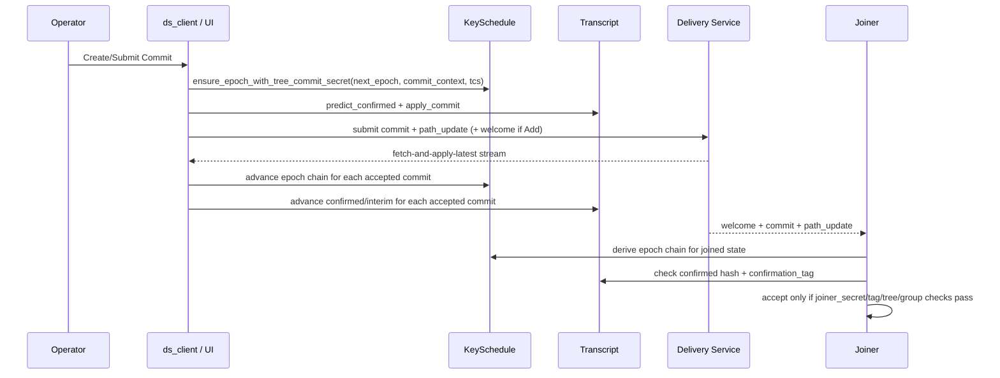

# Key Schedule + Transcript Transitions Per Action (Simple View)

## Formal Setup
This page explains how key-schedule secrets and transcript hashes move for each major action.

Let:
- $S_e$ be local group state at epoch $e$.
- $M_e=\mathrm{encode}(\mathrm{commit}_e)$ be commit context bytes.
- $h_e=\mathrm{tree\_hash}(T_e)$ be tree hash after commit apply.
- $\mathrm{tcs}_e=\mathrm{LineageCommitSecretInput}(\mathrm{commit}_e)$ (optional TreeKEM lineage input).
- $\mathrm{CS}_e=(\mathrm{gch}_e,\mathrm{commit\_secret}_e,\mathrm{joiner\_secret}_e,\mathrm{welcome\_secret}_e,\mathrm{epoch\_secret}_e,\mathrm{root\_secret}_e)$ be epoch chain secrets.
- $\mathrm{DS}_e=(\mathrm{confirmation\_key}_e,\mathrm{membership\_key}_e,\mathrm{sender\_data\_key}_e,\mathrm{handshake\_secret}_e,\mathrm{application\_secret}_e,\mathrm{exporter\_secret}_e)$ be derived epoch secrets.
- $\mathrm{TH}_e=(\mathrm{confirmed}_e,\mathrm{interim}_e)$ be transcript state.

Actions covered:
- create-group (epoch 0 bootstrap)
- create-commit (add/update/remove families)
- apply-received-commit
- join-from-welcome / UI join-from-latest
- fetch-and-apply-latest / UI sync

RFC 9420 Basis:
- Uses RFC-style chain naming and transcript/confirmation concepts (`joiner_secret`, `welcome_secret`, `epoch_secret`, `confirmation_tag`, transcript hashes).
- This document maps those concepts to concrete code transitions in your implementation.

Suspicious Findings:
- Live proposal queueing does not feed proposal bytes into transcript interim hash updates before commit apply.
- `GroupInfo.signature` is generated as a project hash placeholder and is not verified during Welcome validation.
- TreeKEM lineage commit input is derived from root-path public key material by implementation-specific helper.

## Mathematical Flow
1. Epoch-0 bootstrap (`create-group`)
   Inputs: $g,T_0,o$
   Outputs: $S_0,\mathrm{CS}_0,\mathrm{DS}_0,\mathrm{TH}_0$
   Equation:
   $$
   S_0=\mathrm{ClientGroupState::new}(g,T_0,o),\quad \mathrm{epoch}(S_0)=0
   $$
   $$
   \mathrm{init\_secret}=\mathrm{HashLabel}(\text{"init\_secret"},g,[g,h_0])
   $$
   with initial chain + transcript seeded from $(g,h_0)$.
   Example: first local state file already contains epoch-0 key schedule and transcript.
   RFC 9420 Basis: initial group context and epoch-0 secret state.
   Suspicious Finding: local bootstrap convenience (no wire Commit/Welcome exchange in this step).

2. Commit-driven chain transition (`create-commit`, receiver apply, sync)
   Inputs: $\mathrm{root\_secret}_{e-1},M_e,h_e,\mathrm{tcs}_e$
   Outputs: $\mathrm{CS}_e$
   Equation:
   $$
   \mathrm{gch}_e=\mathrm{HashLabel}(\text{"group\_context"},g,[g,e,h_e,M_e])
   $$
   $$
   \mathrm{commit\_secret}_e=\mathrm{HashLabel}(\text{"commit\_secret"},g,[\mathrm{root\_secret}_{e-1},e,h_e,M_e,\mathrm{tcs}_e?])
   $$
   $$
   \mathrm{joiner\_secret}_e=\mathrm{HashLabel}(\text{"joiner\_secret"},g,[\mathrm{root\_secret}_{e-1},\mathrm{commit\_secret}_e,e])
   $$
   $$
   \mathrm{welcome\_secret}_e=\mathrm{HashLabel}(\text{"welcome\_secret"},g,[\mathrm{joiner\_secret}_e,h_e,M_e])
   $$
   $$
   \mathrm{epoch\_secret}_e=\mathrm{HashLabel}(\text{"epoch\_secret"},g,[\mathrm{joiner\_secret}_e,h_e,e])
   $$
   $$
   \mathrm{root\_secret}_e=\mathrm{HashLabel}(\text{"root\_secret"},g,[\mathrm{epoch\_secret}_e,\mathrm{welcome\_secret}_e,e])
   $$
   Example: every accepted commit advances epoch and appends one new chain node.
   RFC 9420 Basis: per-epoch secret chain advancement with commit-linked context.
   Suspicious Finding: $\mathrm{tcs}_e$ helper is implementation-specific (derived from commit path root parent key input).

3. Per-epoch derived secret expansion
   Inputs: $\mathrm{epoch\_secret}_e,\mathrm{gch}_e,g,e$
   Outputs: $\mathrm{DS}_e$
   Equation:
   $$
   (\mathrm{confirmation\_key}_e,\mathrm{membership\_key}_e,\mathrm{sender\_data\_key}_e)=\mathrm{StageKeys}(\mathrm{epoch\_secret}_e,\mathrm{gch}_e)
   $$
   $$
   \mathrm{handshake\_secret}_e=\mathrm{HashLabel}(\text{"handshake\_secret"},\mathrm{gch}_e,[\mathrm{epoch\_secret}_e,g,e])
   $$
   $$
   \mathrm{application\_secret}_e=\mathrm{HashLabel}(\text{"application\_secret"},\mathrm{gch}_e,[\mathrm{epoch\_secret}_e,g,e])
   $$
   $$
   \mathrm{exporter\_secret}_e=\mathrm{HashLabel}(\text{"exporter\_secret"},\mathrm{gch}_e,[\mathrm{epoch\_secret}_e,g,e])
   $$
   Example: `show-derived-secrets` reads from this expansion.
   RFC 9420 Basis: epoch secret fanout into stage/application/exporter style keys.
   Suspicious Finding: None.

4. Transcript transition on commit apply
   Inputs: $\mathrm{TH}_{e-1},M_e,\mathrm{confirmation\_tag}_e$
   Outputs: $\mathrm{TH}_e$
   Equation:
   $$
   \mathrm{predicted\_confirmed}_e=\mathrm{H}(\mathrm{interim}_{e-1},\mathrm{H}(\text{"commit"},M_e))
   $$
   $$
   \mathrm{confirmation\_tag}_e=\mathrm{H}(\text{"confirmation\_tag"},\mathrm{confirmation\_key}_e,\mathrm{predicted\_confirmed}_e)
   $$
   $$
   \mathrm{confirmed}_e=\mathrm{predicted\_confirmed}_e,\quad
   \mathrm{interim}_e=\mathrm{H}(\text{"interim"},\mathrm{confirmed}_e,\mathrm{confirmation\_tag}_e)
   $$
   Example: when commit apply succeeds, transcript confirmed hash advances exactly once.
   RFC 9420 Basis: confirmed/interim transcript pipeline and confirmation-tag binding.
   Suspicious Finding: proposal queue path stores pending proposals but does not call transcript proposal-record step in live flows.

5. Welcome generation and joiner validation linkage
   Inputs: commit at epoch $e-1$, projected epoch $e$, $\mathrm{CS}_e,\mathrm{DS}_e,\mathrm{TH}_{e-1}$
   Outputs: `Welcome` + validation decision
   Equation:
   $$
   \mathrm{GroupInfo.confirmed\_transcript\_hash}=\mathrm{predict\_confirmed}(\mathrm{TH}_{e-1},M_e)
   $$
   $$
   \mathrm{GroupInfo.confirmation\_tag}=\mathrm{Tag}(\mathrm{confirmation\_key}_e,\mathrm{GroupInfo.confirmed\_transcript\_hash})
   $$
   $$
   \mathrm{GroupSecrets.joiner\_secret}=\mathrm{joiner\_secret}_e
   $$
   Joiner accepts iff:
   $$
   \mathrm{GroupSecrets.joiner\_secret}=\mathrm{joiner\_secret}_e^{local}
   \land
   \mathrm{verify\_tag}(\mathrm{confirmation\_key}_e,\mathrm{confirmed\_hash},\mathrm{confirmation\_tag})=1
   $$
   Example: wrong receiver private or mismatched local tree/transcript causes Welcome rejection.
   RFC 9420 Basis: Welcome, GroupInfo, confirmation binding, and joiner consistency checks.
   Suspicious Finding: `GroupInfo.signature` field is not part of current joiner verification gate.

6. Per-action summary matrix (what changes)
   Inputs: action $a$
   Outputs: changed state components
   Equation:
   $$
   \Delta(a)\subseteq\{\mathrm{epoch},\mathrm{CS},\mathrm{DS},\mathrm{TH},\mathrm{tree},\mathrm{Welcome}\}
   $$

   | Action | Epoch | Chain Secrets (`CS`) | Derived Secrets (`DS`) | Transcript (`TH`) | Welcome |
   |---|---|---|---|---|---|
   | `create-group` | initialize $e=0$ | initialize | initialize | initialize | no |
   | `create-commit` (Add/Update/Remove) | $e \to e+1$ locally | append epoch node | recompute for new epoch | apply commit transition | generated only if Add exists |
   | `apply-received-commit` | $e \to e+1$ | append epoch node | recompute for new epoch | apply commit transition | not generated |
   | `join-from-welcome` / UI `join-from-latest` | bootstrap then $e \to e+1$ | build + verify against Welcome | derive for joined epoch | apply commit transition + verify GroupInfo hash/tag | consumed/validated |
   | `fetch-and-apply-latest` / UI sync | repeated $e \to e+1$ | append per applied commit | recompute per applied commit | apply per commit | consumed only in unknown-group bootstrap mode |

   RFC 9420 Basis: action-dependent state transitions over epochs.
   Suspicious Finding: commit semantic rejection can occur at receiver sync/apply stage rather than DS submit stage.

7. What to Watch (Presentation Callouts)
   Inputs: key-schedule/transcript walkthrough output
   Outputs: callout tuple $(\mathrm{checkpoints},\Delta\mathrm{state},\mathrm{suspicious\_summary})$
   Equation:
   $$
   \mathrm{Callout}_{ks\_th}=(\mathrm{chain\_advance\_clear},\mathrm{tag\_binding\_clear},\mathrm{welcome\_link\_clear})
   $$
   | What to watch | Expected state delta | Suspicious summary |
   |---|---|---|
   | Chain secrets for new epoch are derived with commit context | New epoch node appended (`commit/joiner/welcome/epoch/root` secrets rotate) | TreeKEM commit-secret input helper is implementation-specific |
   | Transcript + confirmation-tag linkage is demonstrated | Confirmed/interim transcript hashes advance with epoch and confirmation binding | Live proposal queue path does not currently record proposal hashes into transcript interim state |
   | Welcome checks link to local chain/transcript | Joiner validation ties `joiner_secret`, confirmed hash, and confirmation tag to local state | `GroupInfo.signature` is not enforced in current joiner validation |
   RFC 9420 Basis: presentation checkpoints over epoch secret lineage and transcript confirmation semantics.
   Suspicious Finding: None (summary step; suspicious items are listed in table).

## Protocol Visual (Mermaid)

## Implementation Traceability
| Symbol/Equation | File:Line | Function Name |
|---|---|---|
| epoch chain node fields (`gch`, `commit_secret`, `joiner_secret`, `welcome_secret`, `epoch_secret`, `root_secret`) | `src/key_schedule.rs:24` | `EpochSecretNode` |
| $\mathrm{ensure\_epoch\_with\_tree\_commit\_secret}$ transition driver | `src/key_schedule.rs:191` | `KeyScheduleState::ensure_epoch_with_tree_commit_secret` |
| chain equations (`commit_secret`/`joiner_secret`/`welcome_secret`/`epoch_secret`/`root_secret`) | `src/key_schedule.rs:404` | `derive_epoch_chain_secrets` |
| group-context hash binding | `src/key_schedule.rs:510` | `derive_group_context_hash` |
| $\mathrm{DS}_e$ derivation (`confirmation`/`membership`/`sender_data` + handshake/application/exporter) | `src/key_schedule.rs:367` | `derive_epoch_secrets` |
| stage-key label derivation (`confirm`,`membership`,`sender_data`) | `src/stage_keys.rs:20` | `derive_epoch_stage_keys_with_context` |
| commit-context epoch advance in local state | `src/client_state.rs:146` | `advance_epoch_internal` |
| commit apply path updates key schedule + transcript together | `src/client_state.rs:157` | `advance_epoch_internal` |
| transcript prediction + apply equations | `src/transcript.rs:62` | `predict_confirmed_after_commit` |
| transcript commit apply transition | `src/transcript.rs:70` | `apply_commit` |
| confirmation-tag derivation and verify | `src/transcript.rs:110` | `derive_confirmation_tag` / `verify_confirmation_tag` |
| TreeKEM lineage input helper $\mathrm{tcs}_e$ | `src/tree.rs:584` | `lineage_commit_secret_input` |
| create-commit local epoch transition | `src/bin/ds_client.rs:1103` | `main` (`CreateCommit`) |
| receiver apply epoch transition | `src/bin/ds_client.rs:1224` | `main` (`ApplyReceivedCommit`) |
| sync epoch transition | `src/bin/ds_client.rs:2819` | `sync_apply_commit_stream` path |
| welcome build uses predicted transcript hash + confirmation tag | `src/bin/ds_client.rs:2302` | `build_welcome_for_commit` |
| welcome encryption with `welcome_secret` | `src/bin/ds_client.rs:2327` | `build_welcome_for_commit` |
| joiner welcome checks (`joiner_secret`, transcript hash, confirmation tag, tree hash) | `src/bin/ds_client.rs:1881` | `validate_welcome_for_joiner` |
| UI join/sync uses same epoch-advance primitive | `src/bin/ds_ui_gateway.rs:5934` | `join-from-latest` apply path |
| UI welcome checks (confirmed hash + confirmation tag) | `src/bin/ds_ui_gateway.rs:6044` | `validate_welcome_for_joiner` |
| `SUSPICIOUS: pending proposals are queued but transcript proposal-record is not called in live flows` | `src/client_state.rs:80` | `queue_proposal` |
| `SUSPICIOUS: transcript proposal-record function exists but is currently unused outside transcript tests/bootstrap` | `src/transcript.rs:54` | `TranscriptState::record_proposal` |
| `SUSPICIOUS: GroupInfo signature is generated as a custom hash placeholder` | `src/bin/ds_client.rs:2314` | `build_welcome_for_commit` |
| `SUSPICIOUS: GroupInfo signature is not enforced in joiner validation` | `src/bin/ds_client.rs:1893` | `validate_welcome_for_joiner` |
| `SUSPICIOUS: semantic invalid commits may persist at DS and fail later at receiver sync` | `src/ds/http.rs:1379` | `parse_and_validate_commit_submission_payload` |
