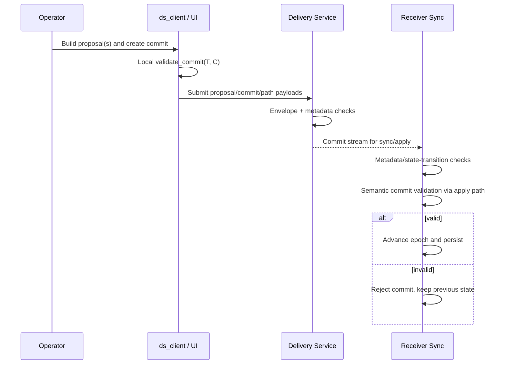

# Proposal Families + Commit Validation Matrix (Simple View)

## Formal Setup
This page explains all proposal families currently supported in commit validation.

Let:
- $P=(p_1,\dots,p_n)$ be commit proposal list.
- $C=(\text{sender},P,\text{path})$ be commit.
- $T$ be current ratchet tree.
- $\mathrm{Valid}(T,C)\in\{0,1\}$ be commit validation result.

Proposal families:
- Add
- Update
- Remove
- PreSharedKey
- ReInit
- GroupContextExtensions

Plain-language meanings:
- Proposal families define allowed state changes before/inside a commit.
- Validation matrix decides which combinations are accepted or rejected.

RFC 9420 Basis:
- Proposal-set validation and proposal conflict rules are MLS commit-processing fundamentals.
- This document maps those rules to your code and DS/receiver behavior.

Suspicious Findings:
- CLI/UI operator flows expose Add/Update/Remove proposal creation directly, but not PSK/ReInit/GroupContextExtensions.
- DS commit submission validates envelope metadata, but does not run full semantic `validate_commit` at submit-time.
- `create-commit` builds from local pending proposal queue, not DS proposal stream.

## Mathematical Flow
1. Define proposal family domain
   Inputs: proposal list $P$
   Outputs: typed family partition
   Equation:
   $$
   P = P_{add}\cup P_{upd}\cup P_{rm}\cup P_{psk}\cup P_{reinit}\cup P_{gce}
   $$
   with disjoint family tags by proposal type.
   Example: one commit can include Add+Update+PSK, but ReInit has stricter rules.
   RFC 9420 Basis: proposal type taxonomy in commit semantics.
   Suspicious Finding: None.

2. Core commit validity predicate
   Inputs: $T,C$
   Outputs: $\mathrm{Valid}(T,C)$ or specific error
   Equation:
   $$
   \mathrm{Valid}(T,C)=1\iff \text{all family constraints hold}
   $$
   sender bound:
   $$
   0\le C.\mathrm{sender}<\mathrm{leaf\_count}(T)
   $$
   Example: sender out-of-bounds rejects commit before family-specific checks.
   RFC 9420 Basis: sender + proposal-set validation before apply.
   Suspicious Finding: None.

3. Validation matrix by proposal family
   Inputs: $T,P$
   Outputs: accept or named rejection error
   Equation (summary):
   $$
   \mathrm{Valid}(T,C)=\bigwedge_k \mathrm{Constraint}_k(T,P)
   $$

   | Family | Constraint | Rejection Error(s) |
   |---|---|---|
   | Add | KeyPackage signature must verify | `InvalidAddKeyPackage` |
   | Add | Added identity must not already exist in tree | `AddIdentityAlreadyMember` |
   | Add | No duplicate add target (identity/init-key) in same commit | `DuplicateAddTarget` |
   | Update | Target leaf index must be in bounds | `UpdateOutOfBounds` |
   | Update | Same leaf cannot be updated twice in one commit | `DuplicateUpdate` |
   | Remove | Target leaf index must be in bounds | `RemoveOutOfBounds` |
   | Remove | Same leaf cannot be removed twice in one commit | `DuplicateRemove` |
   | PSK | `psk_id` must be non-empty | `EmptyPreSharedKeyId` |
   | PSK | `psk_id` values must be unique in commit | `DuplicatePreSharedKey` |
   | ReInit | At most one ReInit in commit | `DuplicateReInit` |
   | ReInit | `group_id` must be non-empty | `EmptyReInitGroupId` |
   | ReInit | version must equal supported value (`1`) | `UnsupportedReInitVersion` |
   | ReInit | cipher suite must equal supported value (`0x0001`) | `UnsupportedReInitCipherSuite` |
   | ReInit | If ReInit exists, proposal set must contain only ReInit | `MixedReInitProposalSet` |
   | GroupContextExtensions | At most one GCE proposal in commit | `DuplicateGroupContextExtensions` |
   | Cross-family | ReInit and GroupContextExtensions cannot appear together | `ReInitAndGroupContextExtensionsConflict` |
   | Cross-family | Same leaf cannot be both Update and Remove in one commit | `UpdateAndRemoveConflict` |

   Example: ReInit + PSK in same commit is rejected by `MixedReInitProposalSet`.
   RFC 9420 Basis: proposal conflict/uniqueness constraints in commit processing.
   Suspicious Finding: supported ReInit version/cipher suite are currently fixed constants in implementation.

4. Apply semantics after validation passes
   Inputs: validated commit $C$
   Outputs: mutated tree/state
   Equation:
   $$
   T' = \mathrm{Apply}(T,C)
   $$
   with family effects:
   $$
   \mathrm{Add/Update/Remove}\Rightarrow\text{tree mutation},\quad \mathrm{PSK/ReInit/GCE}\Rightarrow\text{no direct tree mutation}
   $$
   client-state side-effect:
   $$
   \mathrm{GCE}\Rightarrow \mathrm{group\_context\_extensions}\leftarrow \mathrm{extensions}
   $$
   Example: GroupContextExtensions changes persisted group context, while tree topology stays unchanged.
   RFC 9420 Basis: proposal-family dependent state transitions.
   Suspicious Finding: PSK/ReInit are validation-only in current tree apply path (no additional state transition logic beyond acceptance/rejection).

5. DS submit-time checks vs receiver-time semantic checks
   Inputs: proposal/commit submissions and receiver sync
   Outputs: accept/reject timing
   Equation:
   $$
   \mathrm{DSSubmitChecks}=\mathrm{metadata\_and\_codec\_checks}
   $$
   $$
   \mathrm{SemanticFamilyValidation}=\mathrm{receiver\_side}\;\mathrm{apply/validate}\;\text{path}
   $$
   Example: DS can store a commit that is structurally valid but semantically invalid; receiver later rejects during sync/apply.
   RFC 9420 Basis: implementation layering choice; final protocol safety enforced by receiver processing.
   Suspicious Finding: semantic rejection can be delayed from submit-time to apply-time.

6. DS-backed rejection behavior matrix (observed tests)
   Inputs: crafted invalid commits in DS-backed tests
   Outputs: sync rejection with state unchanged
   Equation:
   $$
   \mathrm{InvalidSemanticCommit}\Rightarrow\mathrm{SyncReject}\land\Delta\mathrm{epoch}=0
   $$

   | Invalid Case | DS-backed Test |
   |---|---|
   | Duplicate GroupContextExtensions | `ds_backed_duplicate_group_context_extensions_commit_rejected_on_sync` |
   | ReInit + GroupContextExtensions conflict | `ds_backed_reinit_and_group_context_extensions_conflict_rejected_on_sync` |
   | Duplicate ReInit | `ds_backed_duplicate_reinit_commit_rejected_on_sync` |
   | Unsupported ReInit params | `ds_backed_unsupported_reinit_params_commit_rejected_on_sync` |
   | Duplicate Add target | `duplicate_add_target_commit_is_rejected_on_sync` |
   | Multi-member noop transition | `strict_receiver_policy_rejects_multimember_noop_commit_transition` |

   Example: receiver rejects invalid commit and keeps previous epoch/state.
   RFC 9420 Basis: receiver must reject invalid commit semantics.
   Suspicious Finding: None.

7. What to Watch (Presentation Callouts)
   Inputs: proposal-validation walkthrough output
   Outputs: callout tuple $(\mathrm{checkpoints},\Delta\mathrm{state},\mathrm{suspicious\_summary})$
   Equation:
   $$
   \mathrm{Callout}_{matrix}=(\mathrm{constraints\_clear},\mathrm{apply\_effects\_clear},\mathrm{reject\_timing\_clear})
   $$
   | What to watch | Expected state delta | Suspicious summary |
   |---|---|---|
   | Family constraints and cross-family conflicts are explained | Invalid proposal sets are rejected and epoch remains unchanged | ReInit support is fixed to implementation constants |
   | Apply effects per family are clear | Add/Update/Remove mutate tree; GCE mutates group context extensions | PSK/ReInit/GCE are not exposed in normal CLI/UI proposal creation flow |
   | DS-vs-receiver validation layering is clear | Semantic invalid commits can be rejected during receiver sync with no state advance | DS submit path does not run full semantic `validate_commit` |
   RFC 9420 Basis: presentation checkpoints over proposal-set validity and commit acceptance/rejection behavior.
   Suspicious Finding: None (summary step; suspicious items are listed in table).

## Protocol Visual (Mermaid)

## Implementation Traceability
| Symbol/Equation | File:Line | Function Name |
|---|---|---|
| proposal family enum | `src/tree.rs:59` | `Proposal` |
| commit validation error enum (matrix outcomes) | `src/tree.rs:246` | `CommitValidationError` |
| family tag constants | `src/tree.rs:1649` | proposal type constants |
| ReInit supported constants (`1`, `0x0001`) | `src/tree.rs:1655` | `REINIT_SUPPORTED_*` |
| global commit validation entry | `src/tree.rs:1092` | `RatchetTree::validate_commit` |
| Add checks (signature/existing/duplicate target) | `src/tree.rs:1113` | `RatchetTree::validate_commit` |
| Update checks (bounds/duplicate) | `src/tree.rs:1131` | `RatchetTree::validate_commit` |
| Remove checks (bounds/duplicate) | `src/tree.rs:1141` | `RatchetTree::validate_commit` |
| PSK checks (non-empty/duplicate) | `src/tree.rs:1151` | `RatchetTree::validate_commit` |
| ReInit checks (duplicate/empty/version/suite) | `src/tree.rs:1159` | `RatchetTree::validate_commit` |
| GroupContextExtensions duplicate check | `src/tree.rs:1183` | `RatchetTree::validate_commit` |
| ReInit+GCE conflict and mixed-ReInit checks | `src/tree.rs:1192` | `RatchetTree::validate_commit` |
| Update+Remove conflict check | `src/tree.rs:1199` | `RatchetTree::validate_commit` |
| apply semantics: Add/Update/Remove mutate tree | `src/tree.rs:849` | `RatchetTree::apply_commit` |
| apply semantics: PSK/ReInit/GCE tree no-op | `src/tree.rs:867` | `RatchetTree::apply_commit` |
| GCE state mutation in client state | `src/client_state.rs:235` | `apply_group_context_extensions_from_proposals` |
| commit builder uses local pending proposal queue | `src/bin/ds_client.rs:2199` | `build_commit_from_pending` |
| operator commands for proposal creation (A/U/R exposed) | `src/bin/ds_client.rs:185` | `Commands::Create*Proposal` |
| UI action routes (A/U/R exposed) | `src/bin/ds_ui_gateway.rs:535` | router setup |
| DS proposal submit group check | `src/ds/http.rs:1360` | `validate_proposal_submission_payload` |
| DS commit submit metadata/path checks | `src/ds/http.rs:1379` | `parse_and_validate_commit_submission_payload` |
| receiver transition guard (multi-member noop reject) | `src/bin/ds_client.rs:2073` | `validate_commit_state_machine_transition` |
| DS-backed test: duplicate GCE reject | `tests/ds_fetch_apply_e2e.rs:9670` | `ds_backed_duplicate_group_context_extensions_commit_rejected_on_sync` |
| DS-backed test: ReInit+GCE conflict reject | `tests/ds_fetch_apply_e2e.rs:9808` | `ds_backed_reinit_and_group_context_extensions_conflict_rejected_on_sync` |
| DS-backed test: duplicate ReInit reject | `tests/ds_fetch_apply_e2e.rs:9948` | `ds_backed_duplicate_reinit_commit_rejected_on_sync` |
| DS-backed test: unsupported ReInit params reject | `tests/ds_fetch_apply_e2e.rs:10091` | `ds_backed_unsupported_reinit_params_commit_rejected_on_sync` |
| DS-backed test: duplicate Add target reject | `tests/ds_fetch_apply_e2e.rs:11103` | `duplicate_add_target_commit_is_rejected_on_sync` |
| DS-backed test: strict transition noop reject | `tests/ds_fetch_apply_e2e.rs:10774` | `strict_receiver_policy_rejects_multimember_noop_commit_transition` |
| `SUSPICIOUS: CLI/UI do not expose PSK/ReInit/GCE creation in standard action flows` | `src/bin/ds_client.rs:185` | `Commands::Create*Proposal` |
| `SUSPICIOUS: DS submit path does not call full RatchetTree::validate_commit` | `src/ds/http.rs:1379` | `parse_and_validate_commit_submission_payload` |
| `SUSPICIOUS: semantic invalid commits can be stored then rejected at receiver sync` | `tests/ds_fetch_apply_e2e.rs:9670` | DS-backed rejection tests |
