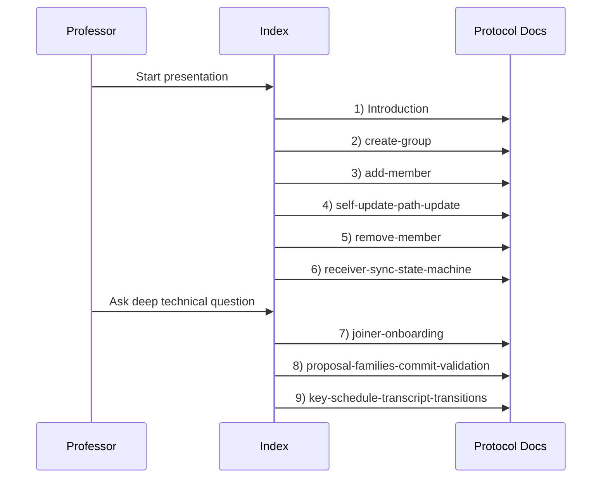

# Protocol Action Presentation Index (Simple View)

## Formal Setup
This page is the presentation roadmap for all protocol-action docs.

Let:
- $\mathcal{D}$ be the set of protocol docs in `/protocol-actions/`.
- $\mathcal{R}$ be recommended reading order.
- $\mathcal{C}$ be the core story for a professor demo.
- $\mathcal{X}$ be extra deep-dive documents.

Goal:
- Keep narration human-readable.
- Keep each stop grounded in RFC 9420 semantics and your real code.
- Keep suspicious implementation deviations visible during presentation.

RFC 9420 Basis:
- The order follows MLS lifecycle logic: bootstrap state, membership change, update, sync, and validation.

Suspicious Findings:
- External commit/join command surface is not exposed in current CLI command set.
- Welcome onboarding logic is implemented in parallel CLI and UI paths (risk of drift if not kept aligned).
- Application message transport exists in code but is not in the primary professor presentation path yet.

## Mathematical Flow
1. Build the presentation order
   Inputs: $\mathcal{D}$
   Outputs: $\mathcal{R}$
   Equation:
   $$
   \mathcal{R}=\mathcal{C}\cup\mathcal{X}
   $$
   with:
   $$
   \mathcal{C}=[\text{Introduction},\text{create-group},\text{add-member},\text{self-update-path-update},\text{remove-member},\text{receiver-sync-state-machine}]
   $$
   Example: this is the shortest complete narrative from "group born" to "members converge after changes."
   RFC 9420 Basis: mirrors group setup, TreeKEM updates, and commit processing lifecycle.
   Suspicious Finding: None.

2. Primary reading order (use this in class)
   Inputs: $\mathcal{R}$
   Outputs: ordered walkthrough
   Equation:
   $$
   \mathrm{Primary}(\mathcal{R})=(1,\dots,6)
   $$

   | Order | Document | Why This Step |
   |---|---|---|
   | 1 | `Introduction.md` | Defines identity/init key/ratchet tree/index basics first |
   | 2 | `create-group.md` | Shows epoch-0 bootstrap and initial state shape |
   | 3 | `add-member.md` | Shows proposal + commit + path + Welcome creation path |
   | 4 | `self-update-path-update.md` | Shows forward-secrecy-style update mechanics |
   | 5 | `remove-member.md` | Shows membership revocation and post-remove behavior |
   | 6 | `receiver-sync-state-machine.md` | Shows how receivers fetch/apply safely and converge |

   Example: if professor asks "what happens when someone is added then others sync?", steps 3 then 6 answer it.
   RFC 9420 Basis: commit/apply/sync flow across epochs.
   Suspicious Finding: None.

3. Deep-dive reading order (after primary)
   Inputs: remaining docs in $\mathcal{D}$
   Outputs: advanced explanation path
   Equation:
   $$
   \mathcal{X}=[\text{joiner-onboarding},\text{proposal-families-commit-validation},\text{key-schedule-transcript-transitions}]
   $$

   | Order | Document | Why It Matters |
   |---|---|---|
   | 7 | `joiner-onboarding.md` | Explains join-from-welcome and UI join-from-latest |
   | 8 | `proposal-families-commit-validation.md` | Explains what proposal combinations are legal/illegal |
   | 9 | `key-schedule-transcript-transitions.md` | Explains exact secret and transcript movement per action |

   Example: if asked "why was a commit rejected?", step 8 gives matrix-level answer.
   RFC 9420 Basis: proposal validity, Welcome validation, transcript/key schedule linkage.
   Suspicious Finding: pending deep dives for Welcome lifecycle/external commit/app messages are separate tasks.

4. Presentation checkpoint map (quick Q/A routing)
   Inputs: question type $q$
   Outputs: target document $d$
   Equation:
   $$
   f(q)\rightarrow d
   $$

   | Question Type | Read This First |
   |---|---|
   | "What is identity/init_key/RatchetTree?" | `Introduction.md` |
   | "How is group created?" | `create-group.md` |
   | "How is a member added?" | `add-member.md` |
   | "How does path update work?" | `self-update-path-update.md` |
   | "How is someone removed?" | `remove-member.md` |
   | "How do others catch up safely?" | `receiver-sync-state-machine.md` |
   | "How does new member join from Welcome?" | `joiner-onboarding.md` |
   | "Which proposal combinations are invalid?" | `proposal-families-commit-validation.md` |
   | "How do secrets/transcripts evolve by epoch?" | `key-schedule-transcript-transitions.md` |

   Example: this table is your fast answer index during live professor Q/A.
   RFC 9420 Basis: operational mapping over MLS object lifecycle.
   Suspicious Finding: None.

5. What to Watch (Presentation Callouts)
   Inputs: presentation plan state
   Outputs: callout tuple $(\mathrm{checkpoints},\Delta\mathrm{state},\mathrm{suspicious\_summary})$
   Equation:
   $$
   \mathrm{Callout}_{index}=(\mathrm{primary\_path\_ready},\mathrm{deep\_dive\_ready},\mathrm{gap\_visibility})
   $$
   | What to watch | Expected state delta | Suspicious summary |
   |---|---|---|
   | Primary order is used first in class | No protocol-state change; presentation flow becomes deterministic | None |
   | Deep-dive docs are used only when needed | No protocol-state change; Q/A routing becomes faster | None |
   | Pending coverage gaps are explicitly called out | No protocol-state change; audience gets honest implementation-status boundaries | Welcome lifecycle, external join/commit, and app-message deep-dive docs remain pending tasks |
   RFC 9420 Basis: presentation-layer guidance aligned to MLS action lifecycle explanation.
   Suspicious Finding: None (summary step; suspicious items are listed in table).

## Protocol Visual (Mermaid)

## Implementation Traceability
| Symbol/Equation | File:Line | Function Name |
|---|---|---|
| $\mathcal{C}$ baseline sequence anchored to bootstrap command | `src/bin/ds_client.rs:522` | `main` (`Commands::BootstrapGroupState`) |
| add-member action entry | `src/bin/ds_client.rs:968` | `main` (`Commands::CreateAddProposal`) |
| self-update action entry | `src/bin/ds_client.rs:997` | `main` (`Commands::CreateUpdateProposal`) |
| remove-member action entry | `src/bin/ds_client.rs:1034` | `main` (`Commands::CreateRemoveProposal`) |
| commit creation entry | `src/bin/ds_client.rs:1067` | `main` (`Commands::CreateCommit`) |
| receiver apply entry | `src/bin/ds_client.rs:1131` | `main` (`Commands::ApplyReceivedCommit`) |
| joiner onboarding CLI entry | `src/bin/ds_client.rs:1294` | `main` (`Commands::JoinFromWelcome`) |
| receiver sync CLI entry | `src/bin/ds_client.rs:1368` | `main` (`Commands::FetchAndApplyLatest`) |
| UI onboarding route | `src/bin/ds_ui_gateway.rs:532` | router (`/join-from-latest`) |
| UI commit/sync routes | `src/bin/ds_ui_gateway.rs:524` | router (`/commit-from-pending`) |
| proposal/commit validation matrix root | `src/tree.rs:1092` | `RatchetTree::validate_commit` |
| key schedule + transcript transition root | `src/client_state.rs:146` | `advance_epoch_internal` |
| `SUSPICIOUS: external commit/join command surface is not exposed in current CLI enum` | `src/bin/ds_client.rs:75` | `Commands` enum |
| `SUSPICIOUS: Welcome onboarding logic is duplicated across CLI and UI implementations` | `src/bin/ds_client.rs:1817` | `validate_welcome_for_joiner` |
| `SUSPICIOUS: app-message flows exist but are not in primary presentation path` | `src/bin/ds_client.rs:137` | `Commands::SendAppMessage` |
