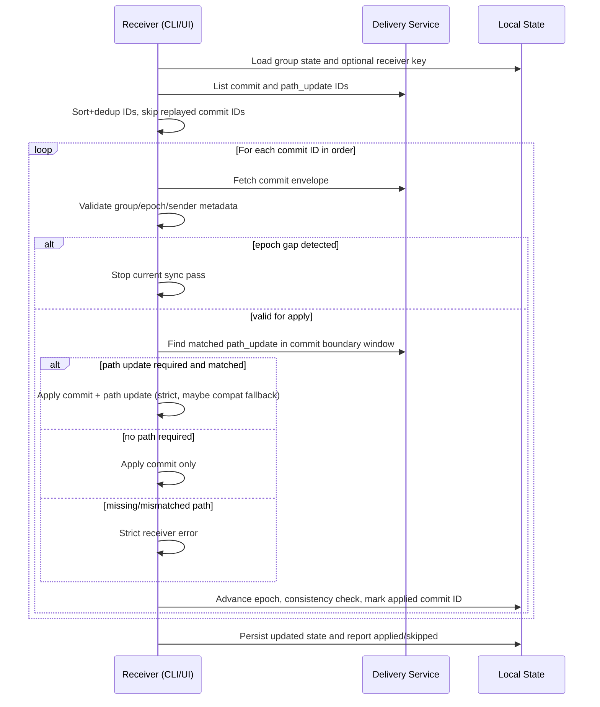

# Receiver Sync State Machine (Simple View)

## Formal Setup
This action documents receiver synchronization for:
- CLI: `fetch-and-apply-latest`
- UI: `sync-apply-latest`

Let:
- $S_e$ be local group state at epoch $e$.
- $I_c=\{c_0,\dots,c_k\}$ be commit message IDs after sort+dedup.
- $I_p=\{p_0,\dots,p_m\}$ be path-update message IDs after sort+dedup.
- $M(c)$ be decoded commit envelope for ID $c$.
- $P(p)$ be decoded path-update envelope for ID $p$.
- $\mathrm{applied\_ids}$ be replay markers stored in local state.
- $sk_r$ be optional receiver private key.

Plain-language meanings:
- Sync walks commits in ID order, validates each one, and applies it.
- Replay markers prevent re-applying old commits.
- When path update is required, sync must find a matching path-update envelope.

RFC 9420 Basis:
- Receiver commit processing, TreeKEM path update processing, and epoch transition checks are MLS core behavior.
- Message-ID scan logic, replay windows, and watch polling are implementation state-machine details.

Suspicious Findings:
- UI sync does not run the explicit commit state-transition guard that CLI runs.
- UI sync requires a matched `path_update` whenever receiver private key exists (CLI only requires it when commit path is non-empty).
- Legacy path-compat fallback can bypass strict lineage binding checks.

## Mathematical Flow
1. Prepare local sync context
   Inputs: local state file, optional receiver private key, sync limit
   Outputs: mutable local state $S_e$, optional $sk_r$
   Equation:
   $$
   S_e=\mathrm{LoadGroupState}(g),\quad sk_r\in\{\varnothing,\text{receiver private}\}
   $$
   Example: CLI may also run unknown-group bootstrap first if no local state exists.
   RFC 9420 Basis: No direct RFC step; local sync bootstrap/context setup.
   Suspicious Finding: None.

2. Optional legacy-compat marker enable
   Inputs: local state, compat flag/env
   Outputs: updated compat marker in state
   Equation:
   $$
   \mathrm{allow\_compat}\land \neg S_e.\mathrm{legacy\_path\_compat}\Rightarrow S_e.\mathrm{legacy\_path\_compat}=1
   $$
   Example: CLI flag `--allow-legacy-path-compat`; UI env `DS_UI_ALLOW_LEGACY_PATH_COMPAT`.
   RFC 9420 Basis: No direct RFC step; migration compatibility behavior.
   Suspicious Finding: legacy fallback weakens strict lineage guarantees for migrated artifacts.

3. Fetch commit/path streams and canonicalize IDs
   Inputs: DS `commit` and `path_update` summaries
   Outputs: sorted unique ID sets $I_c, I_p$
   Equation:
   $$
   I_c=\mathrm{SortDedupParseInt}(\mathrm{commit\_ids}),\quad I_p=\mathrm{SortDedupParseInt}(\mathrm{path\_ids})
   $$
   Example: invalid/non-numeric IDs are ignored.
   RFC 9420 Basis: No direct RFC step; transport-layer ordering helper.
   Suspicious Finding: None.

4. Replay and duplicate suppression
   Inputs: commit ID $c$, state replay markers
   Outputs: skip/apply decision
   Equation:
   $$
   c\in \mathrm{applied\_ids}\Rightarrow \mathrm{skip}
   $$
   $$
   \mathrm{mark\_applied\_commit\_id}(c)\;\text{after successful apply}
   $$
   Example: old commit IDs from DS are skipped without changing epoch.
   RFC 9420 Basis: No direct RFC step; implementation replay hardening.
   Suspicious Finding: None.

5. Decode commit and gate by metadata/epoch
   Inputs: fetched commit bytes for $c$
   Outputs: decoded commit envelope or skip/stop
   Equation:
   $$
   M(c)=\mathrm{DecodeCommitEnvelope}(c)\;\text{else skip}
   $$
   $$
   M(c).group\neq g\Rightarrow\mathrm{skip}
   $$
   $$
   M(c).epoch>S_e.epoch\Rightarrow\mathrm{stop\_on\_gap}
   $$
   $$
   \mathrm{ValidateCommitMetadata}(S_e,M(c))=1
   $$
   Example: future-epoch commit stops this poll to preserve state-machine ordering.
   RFC 9420 Basis: commit context/epoch consistency.
   Suspicious Finding: UI stops on epoch gap silently (CLI logs explicit stop reason).

6. Commit transition validation (CLI strict guard)
   Inputs: $S_e, M(c)$
   Outputs: accept/reject transition
   Equation:
   $$
   \mathrm{InvalidTransition}(M(c),S_e)\Rightarrow\mathrm{error}
   $$
   Example: multi-member commit with empty proposals and empty path is rejected in CLI pre-check.
   RFC 9420 Basis: implementation state-machine integrity rule.
   Suspicious Finding: UI sync currently does not run this explicit guard.

7. Path-update candidate window and match
   Inputs: current commit id $c$, next commit id $c_{next}$, path IDs $I_p$
   Outputs: matched path envelope or missing/mismatch
   Equation:
   $$
   \mathrm{Candidates}(c)=\{p\in I_p\mid c<p<c_{next}\}\;\text{(or }p>c\text{ if no }c_{next})
   $$
   $$
   \mathrm{Match}(P(p),M(c)):\;group,epoch,sender\;\text{all equal}
   $$
   Example: sync scans only path updates in the commit boundary window.
   RFC 9420 Basis: commit/path metadata coherence requirement.
   Suspicious Finding: None.

8. Apply commit with/without path update
   Inputs: $S_e, M(c), P(p), sk_r$
   Outputs: next state $S_{e+1}$ or error
   Equation:
   $$
   \mathrm{path\_required}(M(c))=\neg\mathrm{empty}(M(c).commit.path)
   $$
   CLI rule:
   $$
   \mathrm{path\_required}\land \neg\mathrm{matched\_path}\Rightarrow\mathrm{error}
   $$
   $$
   \neg\mathrm{path\_required}\Rightarrow\mathrm{ApplyCommitOnly}
   $$
   Receiver path apply:
   $$
   S_{e+1}=\mathrm{ApplyCommitWithPathUpdate}(S_e,M(c),P(p),sk_r)
   $$
   Compat fallback:
   $$
   \mathrm{StrictFail}\land \mathrm{allow\_compat}\Rightarrow\mathrm{ApplyLegacyCompat}
   $$
   Example: strict apply failure can still pass under compat mode for legacy artifacts.
   RFC 9420 Basis: TreeKEM receiver apply + optional implementation migration mode.
   Suspicious Finding: UI currently enforces matched path whenever $sk_r$ exists, even if commit path is empty.

9. Finalize state transition and persist
   Inputs: applied commit result
   Outputs: persisted state and counters
   Equation:
   $$
   S\leftarrow\mathrm{ApplyGroupContextExtensions}(S,M(c).proposals)
   $$
   $$
   S\leftarrow\mathrm{AdvanceEpoch}(S,\mathrm{commit\_context},\mathrm{tree\_commit\_secret})
   $$
   $$
   \mathrm{EnsureConsistency}(S)=1,\quad \mathrm{mark\_applied\_commit\_id}(c)
   $$
   Example: CLI/UI both clear pending proposals, advance epoch, run consistency check, then record applied ID.
   RFC 9420 Basis: post-commit epoch/key-schedule progression.
   Suspicious Finding: None.

10. Poll loop behavior (single poll vs watch)
   Inputs: `watch`, `max_polls`, poll interval
   Outputs: repeated sync cycles or one-shot completion
   Equation:
   $$
   \mathrm{watch}=0\Rightarrow\text{one poll};\quad \mathrm{watch}=1\Rightarrow\text{repeat until max/stop}
   $$
   Example: CLI watch mode repeatedly polls DS; UI endpoint is one-shot per request.
   RFC 9420 Basis: No direct RFC step; operational polling behavior.
   Suspicious Finding: None.

11. What to Watch (Presentation Callouts)
   Inputs: receiver-sync walkthrough output
   Outputs: callout tuple $(\mathrm{checkpoints},\Delta\mathrm{state},\mathrm{suspicious\_summary})$
   Equation:
   $$
   \mathrm{Callout}_{sync}=(\mathrm{id\_ordering\_safe},\mathrm{apply\_guards\_pass},\mathrm{state\_advanced})
   $$
   | What to watch | Expected state delta | Suspicious summary |
   |---|---|---|
   | Commit/path IDs are canonicalized and replay-filtered | Duplicate/stale commits are skipped safely | None |
   | Metadata, transition, and path-match guards pass before apply | Invalid transitions/path mismatches are rejected before state advance | CLI/UI guard behavior is not fully identical in all branches |
   | Finalize step runs for each accepted commit | Epoch increments, pending proposals clear, key schedule/transcript advance, applied ID marker updates | Legacy-compat mode can relax strict lineage for migrated artifacts |
   RFC 9420 Basis: presentation checkpoints over safe receiver commit ingestion and epoch progression.
   Suspicious Finding: None (summary step; suspicious items are listed in table).

## Protocol Visual (Mermaid)

## Implementation Traceability
| Symbol/Equation | File:Line | Function Name |
|---|---|---|
| CLI sync command entry | `src/bin/ds_client.rs:1368` | `Commands::FetchAndApplyLatest` |
| unknown-group bootstrap preconditions | `src/bin/ds_client.rs:1404` | `main` (FetchAndApplyLatest arm) |
| CLI compat marker enable + persist | `src/bin/ds_client.rs:1395` | `main` (FetchAndApplyLatest arm) |
| CLI one-poll/watch loop | `src/bin/ds_client.rs:1429` | `main` (FetchAndApplyLatest arm) |
| CLI per-poll state machine | `src/bin/ds_client.rs:2617` | `fetch_and_apply_latest_once` |
| list `commit` and `path_update` streams | `src/bin/ds_client.rs:2628` | `ds_list_messages` (call site) |
| parse/sort/dedup ID lists | `src/bin/ds_client.rs:3095` | `extract_sorted_unique_message_ids` |
| replay skip check | `src/bin/ds_client.rs:2668` | `fetch_and_apply_latest_once` |
| epoch-gap stop behavior | `src/bin/ds_client.rs:2701` | `fetch_and_apply_latest_once` |
| commit metadata validation | `src/bin/ds_client.rs:2041` | `validate_commit_envelope_metadata` |
| commit transition strict guard (CLI) | `src/bin/ds_client.rs:2073` | `validate_commit_state_machine_transition` |
| path-required predicate (CLI) | `src/bin/ds_client.rs:2069` | `commit_requires_path_update` |
| path candidate window | `src/bin/ds_client.rs:3107` | `candidate_path_update_ids` |
| path envelope metadata match | `src/bin/ds_client.rs:2088` | `validate_path_update_envelope_metadata` |
| strict path-missing rejection | `src/bin/ds_client.rs:2798` | `fetch_and_apply_latest_once` |
| strict+legacy apply fallback | `src/bin/ds_client.rs:2758` | `fetch_and_apply_latest_once` |
| epoch advance + consistency + replay mark | `src/bin/ds_client.rs:2818` | `fetch_and_apply_latest_once` |
| replay marker APIs | `src/client_state.rs:96` | `has_applied_commit_id` / `mark_applied_commit_id` |
| UI sync API route | `src/bin/ds_ui_gateway.rs:528` | router setup |
| UI sync action entry | `src/bin/ds_ui_gateway.rs:6585` | `action_sync_apply_latest` |
| UI compat toggle source (env) | `src/bin/ds_ui_gateway.rs:589` | `ui_allow_legacy_path_compat` |
| UI compat marker enable/persist policy | `src/bin/ds_ui_gateway.rs:6606` | `action_sync_apply_latest` |
| UI per-request sync state machine | `src/bin/ds_ui_gateway.rs:6346` | `fetch_and_apply_latest_once` |
| UI replay skip check | `src/bin/ds_ui_gateway.rs:6386` | `fetch_and_apply_latest_once` |
| UI epoch-gap stop branch | `src/bin/ds_ui_gateway.rs:6419` | `fetch_and_apply_latest_once` |
| UI strict path-missing rejection | `src/bin/ds_ui_gateway.rs:6450` | `fetch_and_apply_latest_once` |
| UI strict+legacy apply fallback | `src/bin/ds_ui_gateway.rs:6464` | `fetch_and_apply_latest_once` |
| UI epoch advance + consistency + replay mark | `src/bin/ds_ui_gateway.rs:6498` | `fetch_and_apply_latest_once` |
| `SUSPICIOUS: UI sync lacks explicit commit transition guard used by CLI` | `src/bin/ds_ui_gateway.rs:6346` | `fetch_and_apply_latest_once` |
| `SUSPICIOUS: UI requires matched path_update whenever receiver key exists` | `src/bin/ds_ui_gateway.rs:6450` | `fetch_and_apply_latest_once` |
| `SUSPICIOUS: legacy compat fallback can bypass strict lineage` | `src/bin/ds_client.rs:2767` | `fetch_and_apply_latest_once` |
