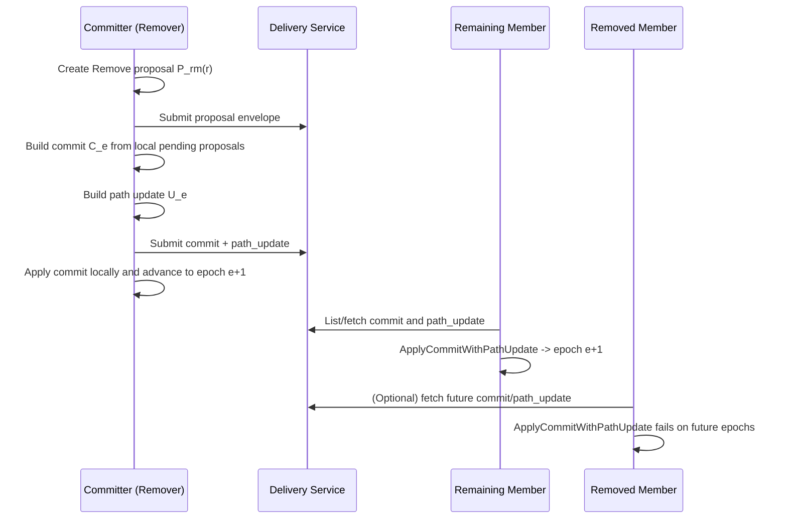

# Remove Member (Simple View)

## Formal Setup
This action is the full remove-member chain:
- proposer creates `Remove` proposal,
- committer builds commit + path update,
- existing members sync/apply,
- removed member loses future decryption ability.

Let:
- $g$ be group id.
- $e$ be current epoch before remove.
- $r$ be removed leaf index.
- $s$ be committer sender leaf.
- $P_{rm}=\mathrm{Remove}(r)$.
- $C_e$ be commit at epoch $e$.
- $U_e$ be the path-update payload paired with $C_e$.
- $S_e^i$ be local state of member $i$ at epoch $e$.

Plain-language meanings:
- Proposal says: "Remove leaf $r$ from the group."
- Commit makes the removal real and rotates TreeKEM secrets.
- Active members move to epoch $e+1$.
- Removed member should fail on future path-update decryption.

RFC 9420 Basis:
- Remove proposal, Commit processing, and TreeKEM secret update are core MLS semantics.
- This document maps those semantics directly to your code and marks implementation-specific behavior.

Suspicious Findings:
- Commit is built from local `pending_proposals` queue, not DS proposal list.
- Self-remove by sender is rejected late (during commit build), not at remove-proposal creation time.
- Optional legacy path-compat fallback can bypass strict lineage validation.

## Mathematical Flow
1. Create local Remove proposal envelope
   Inputs: $S_e^{\mathrm{committer}}, r, s$
   Outputs: proposal envelope $E_{prop}$ and updated local queue $Q_e$
   Equation:
   $$
   P_{rm}=\mathrm{Remove}(r)
   $$
   $$
   E_{prop}=(g,e,s,P_{rm}),\quad Q_e \leftarrow Q_e \cup \{P_{rm}\}
   $$
   Example: Alice creates remove proposal targeting Carol leaf index.
   RFC 9420 Basis: Remove proposal content and epoch-bound proposal semantics.
   Suspicious Finding: self-remove is not rejected here yet.

2. Submit remove proposal to DS
   Inputs: $E_{prop}$, user signing key
   Outputs: DS stores proposal message
   Equation:
   $$
   \mathrm{sig\_input}_{prop}=\text{"proposal|"}\parallel u\parallel\text{"|"}\parallel g\parallel\text{"|"}\parallel H_{prop}(E_{prop})
   $$
   $$
   \mathrm{SubmitProposal}(g,E_{prop},\sigma(\mathrm{sig\_input}_{prop}))
   $$
   Example: DS lists this message as `kind=proposal`.
   RFC 9420 Basis: authenticated proposal transport (DS layer).
   Suspicious Finding: None.

3. Build commit from local pending proposals
   Inputs: $S_e^{\mathrm{committer}}, Q_e, s$
   Outputs: $C_e$
   Equation:
   $$
   C_e=\mathrm{BuildCommit}(Q_e,s),\quad \mathrm{ValidateCommit}(C_e)=1
   $$
   and sender self-remove guard:
   $$
   \exists\,P_{rm}\in Q_e\;\text{s.t.}\;P_{rm}.leaf=s\Rightarrow\mathrm{error}
   $$
   Example: committer cannot remove itself in this command.
   RFC 9420 Basis: commit proposal-set validation and sender constraints.
   Suspicious Finding: commit input is local queue $Q_e$; DS proposal set is not read.

4. Apply proposals in preview tree and blank removed leaf
   Inputs: tree $T_e$, remove proposal $P_{rm}$
   Outputs: preview tree $\widetilde{T}$
   Equation:
   $$
   \widetilde{T}[\mathrm{leaf\_to\_node}(r)]\leftarrow \mathrm{Blank}
   $$
   Example: removed member slot becomes blank leaf node.
   RFC 9420 Basis: remove proposal effect on tree membership.
   Suspicious Finding: None.

5. Build path update for the remove commit
   Inputs: $\widetilde{T}$, sender $s$, leaf secret $\ell$
   Outputs: $U_e=(\text{path\_secrets},\text{ciphertexts})$ and commit path in $C_e$
   Equation:
   $$
   U_e=\mathrm{BuildPathUpdate}(s,\ell),\quad C_e.\text{path}=\mathrm{ParentUpdatesFromSecretModel}(s,\ell)
   $$
   Example: committer rotates direct-path parent keys after removal.
   RFC 9420 Basis: TreeKEM direct-path update on commit.
   Suspicious Finding: None.

6. Submit commit bundle and update committer local state
   Inputs: $C_e,U_e$
   Outputs: DS stores `commit` and `path_update`; committer state advances to $S_{e+1}$
   Equation:
   $$
   \mathrm{SubmitCommit}(g,C_e,U_e,\varnothing,\sigma(\mathrm{sig\_input}_{commit}))
   $$
   $$
   S_{e+1}^{\mathrm{committer}}=\mathrm{AdvanceEpoch}(\mathrm{ApplyCommit}(S_e^{\mathrm{committer}},C_e))
   $$
   Example: remove-only commit normally carries no Welcome.
   RFC 9420 Basis: commit transport + epoch transition.
   Suspicious Finding: DS checks metadata/decodability, not full semantic validity.

7. Existing members sync/apply commit+path update
   Inputs: $S_e^i$ (non-removed), fetched commit/path, receiver private key
   Outputs: $S_{e+1}^i$
   Equation:
   $$
   S_{e+1}^i=\mathrm{ApplyCommitWithPathUpdate}(S_e^i,C_e,U_e,sk_i)
   $$
   $$
   \neg\mathrm{MatchedPathUpdate}(C_e)\Rightarrow\mathrm{error}\;\text{(strict receiver policy)}
   $$
   Example: Bob syncs and converges to same post-remove tree/epoch as Alice.
   RFC 9420 Basis: receiver commit processing with TreeKEM decapsulation.
   Suspicious Finding: optional legacy-compat mode can apply if strict lineage fails.

8. Post-remove security behavior
   Inputs: removed member stale state $S_{e}^{r}$, later commit/path-update $(C_{e+1},U_{e+1})$
   Outputs: decryption/apply failure for removed member
   Equation:
   $$
   \mathrm{ApplyCommitWithPathUpdate}(S_e^{r},C_{e+1},U_{e+1},sk_r)=\bot
   $$
   Example: after Carol is removed, she cannot process future Bob/Alice path updates.
   RFC 9420 Basis: forward secrecy and exclusion of removed members from future group secrets.
   Suspicious Finding: None.

9. What to Watch (Presentation Callouts)
   Inputs: remove-member walkthrough output
   Outputs: callout tuple $(\mathrm{checkpoints},\Delta\mathrm{state},\mathrm{suspicious\_summary})$
   Equation:
   $$
   \mathrm{Callout}_{remove}=(\mathrm{remove\_proposal\_accepted},\mathrm{survivor\_sync\_ok},\mathrm{removed\_member\_blocked})
   $$
   | What to watch | Expected state delta | Suspicious summary |
   |---|---|---|
   | Remove proposal and commit pipeline complete | Target member leaf becomes blank/removed in post-commit tree | Commit source is local pending queue |
   | Remaining members sync/apply commit + path update | Survivors move to epoch `e+1` with aligned tree/context | DS submit checks are structural/metadata-first |
   | Removed member tries later updates | Removed member fails to decrypt/apply future path updates | Legacy-compat fallback can appear on migrated artifacts |
   RFC 9420 Basis: presentation checkpoints over Remove commit semantics and post-remove exclusion.
   Suspicious Finding: None (summary step; suspicious items are listed in table).

## Protocol Visual (Mermaid)

## Implementation Traceability
| Symbol/Equation | File:Line | Function Name |
|---|---|---|
| `CreateRemoveProposal` command | `src/bin/ds_client.rs:207` | `Commands::CreateRemoveProposal` |
| $E_{prop}=(g,e,s,P_{rm})$ + queue write | `src/bin/ds_client.rs:1034` | `main` (CreateRemoveProposal arm) |
| $Q_e \leftarrow Q_e \cup \{P\}$ | `src/client_state.rs:80` | `ClientGroupState::queue_proposal` |
| proposal submit request | `src/bin/ds_client.rs:674` | `main` (SubmitProposal arm) |
| $\mathrm{sig\_input}_{prop}$ | `src/bin/ds_client.rs:3127` | `proposal_signing_input` |
| $C_e=\mathrm{BuildCommit}(Q_e,s)$ | `src/bin/ds_client.rs:2199` | `build_commit_from_pending` |
| sender self-remove guard | `src/bin/ds_client.rs:2211` | `build_commit_from_pending` |
| $\mathrm{ValidateCommit}(C_e)$ incl remove bounds/duplicates | `src/tree.rs:1092` | `RatchetTree::validate_commit` |
| remove proposal preview effect | `src/bin/ds_client.rs:2382` | `apply_proposals_preview` |
| leaf blanking primitive | `src/tree.rs:1246` | `RatchetTree::remove_leaf` |
| $U_e=\mathrm{BuildPathUpdate}(s,\ell)$ | `src/tree.rs:983` | `RatchetTree::build_path_update` |
| create commit/path files + local apply | `src/bin/ds_client.rs:1067` | `main` (CreateCommit arm) |
| remove-only commit yields no Welcome | `src/bin/ds_client.rs:2269` | `build_welcome_for_commit` |
| commit submit request | `src/bin/ds_client.rs:700` | `main` (SubmitCommit arm) |
| commit/path metadata checks on submit | `src/ds/http.rs:1379` | `parse_and_validate_commit_submission_payload` |
| DS store commit/path (welcome optional) | `src/ds/http.rs:927` | `submit_commit` |
| strict receiver commit transition validation | `src/bin/ds_client.rs:2716` | `fetch_and_apply_latest_once` |
| strict receiver path-match requirement | `src/bin/ds_client.rs:2798` | `fetch_and_apply_latest_once` |
| receiver apply with path update | `src/tree.rs:879` | `RatchetTree::apply_commit_with_path_update` |
| removed member cannot decrypt future path updates (test) | `src/tree.rs:2742` | `forward_secrecy_removed_member_cannot_decrypt_future_path_updates` |
| `SUSPICIOUS: commit uses local pending queue, not DS proposal list` | `src/client_state.rs:80` | `ClientGroupState::queue_proposal` |
| `SUSPICIOUS: self-remove rejected late during commit build` | `src/bin/ds_client.rs:2211` | `build_commit_from_pending` |
| `SUSPICIOUS: legacy path compat fallback can bypass strict lineage` | `src/bin/ds_client.rs:2767` | `fetch_and_apply_latest_once` |
