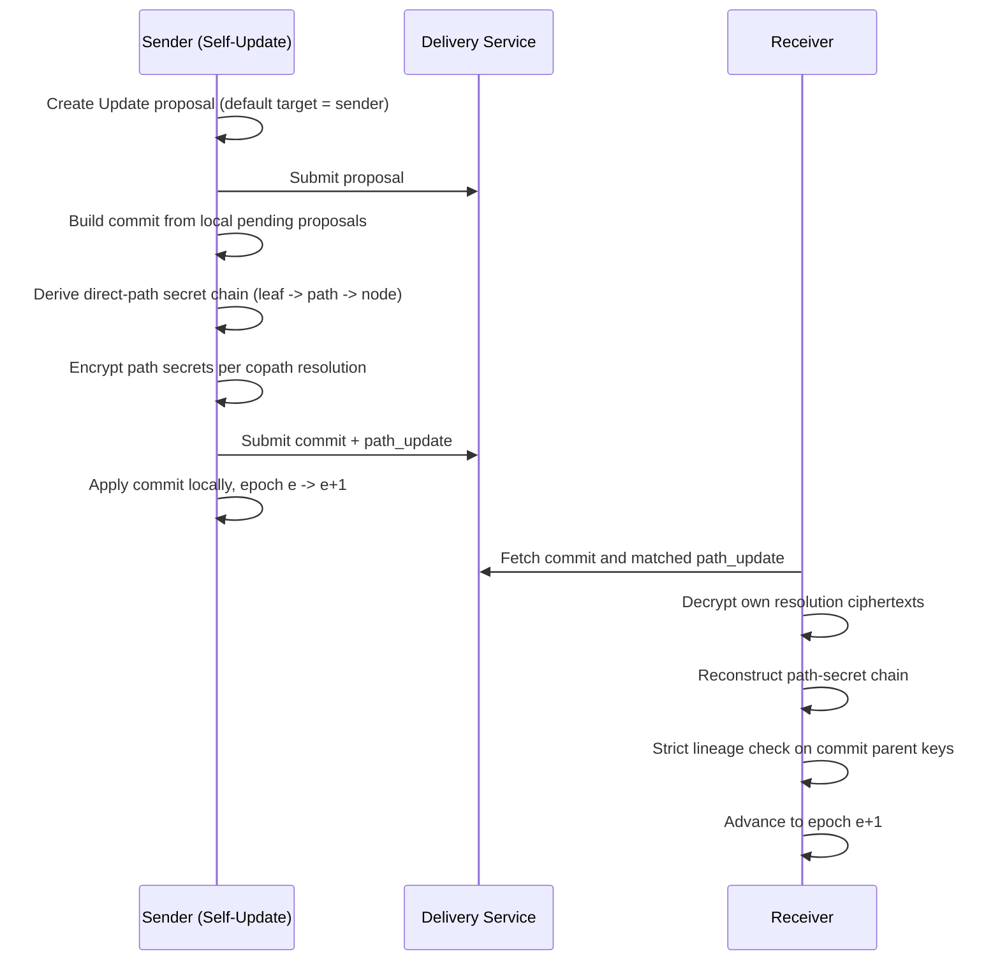

# Self Update / Path Update (Simple View)

## Formal Setup
This action is the self-update chain:
- member creates `Update` proposal (usually for own leaf),
- committer builds commit + path update,
- receivers decrypt matching path ciphertexts,
- strict lineage validation checks parent keys.

Let:
- $g$ be group id.
- $e$ be current epoch before update.
- $s$ be sender leaf (the updater/committer).
- $P_{up}=\mathrm{Update}(s,KP'_s)$ for self-update.
- $C_e$ be commit at epoch $e$.
- $U_e$ be path-update payload paired with $C_e$.
- $\ell_s$ be sender leaf secret.
- $\pi_j$ be path secret at direct-path level $j$.
- $\nu_j$ be node secret at level $j$.

Plain-language meanings:
- Self-update rotates the member leaf key package.
- Commit path carries new parent public keys.
- Path-update ciphertexts carry encrypted path secrets to each receiver resolution node.

RFC 9420 Basis:
- Update proposal, direct-path secret derivation, encrypted path distribution, and receiver apply are core TreeKEM behavior.
- This document is RFC-grounded but follows current code exactly.

Suspicious Findings:
- `create-update-proposal` allows `target_leaf` override, so non-self update can be authored in this path.
- Commit is built from local `pending_proposals` queue, not DS proposal list.
- Optional legacy path-compat fallback can bypass strict lineage binding checks.

## Mathematical Flow
1. Create local update proposal (self by default)
   Inputs: $S_e^{\mathrm{sender}}, s, KP'_s$
   Outputs: proposal envelope $E_{prop}$ and local queue $Q_e$
   Equation:
   $$
   P_{up}=\mathrm{Update}(s,KP'_s)
   $$
   $$
   E_{prop}=(g,e,s,P_{up}),\quad Q_e \leftarrow Q_e \cup \{P_{up}\}
   $$
   Example: Bob creates a fresh keypackage and updates his own leaf.
   RFC 9420 Basis: Update proposal semantics for leaf key rotation.
   Suspicious Finding: command accepts `target_leaf != sender_leaf` if explicitly provided.

2. Submit update proposal to DS
   Inputs: $E_{prop}$, user signing key
   Outputs: DS stores proposal message
   Equation:
   $$
   \mathrm{sig\_input}_{prop}=\text{"proposal|"}\parallel u\parallel\text{"|"}\parallel g\parallel\text{"|"}\parallel H_{prop}(E_{prop})
   $$
   $$
   \mathrm{SubmitProposal}(g,E_{prop},\sigma(\mathrm{sig\_input}_{prop}))
   $$
   Example: DS records this as `kind=proposal`.
   RFC 9420 Basis: authenticated transport layer for proposal messages.
   Suspicious Finding: None.

3. Build commit from local pending proposals
   Inputs: $Q_e, s$
   Outputs: $C_e$
   Equation:
   $$
   C_e=\mathrm{BuildCommit}(Q_e,s),\quad \mathrm{ValidateCommit}(C_e)=1
   $$
   Example: duplicate update to the same leaf in one commit is rejected by validation.
   RFC 9420 Basis: commit proposal-set validation and commit construction.
   Suspicious Finding: commit input set comes from local queue, not DS proposal listing.

4. Apply proposals on preview tree before path derivation
   Inputs: $T_e, P_{up}$
   Outputs: preview tree $\widetilde{T}$
   Equation:
   $$
   \widetilde{T}[\mathrm{leaf\_to\_node}(s)]\leftarrow (KP'_s.\mathrm{init\_key},KP'_s.\mathrm{identity})
   $$
   Example: sender leaf public key changes in preview tree.
   RFC 9420 Basis: Update proposal application to leaf state before path update.
   Suspicious Finding: None.

5. Derive direct-path secret lineage
   Inputs: $\widetilde{T}, s, \ell_s$
   Outputs: per-level $(\pi_j,\nu_j)$ chain and commit parent updates
   Equation:
   $$
   \pi_j=\mathrm{DerivePathSecret}(\pi_{j-1},\mathrm{parent\_node}_j,j),\quad \pi_{-1}=\ell_s
   $$
   $$
   \nu_j=\mathrm{DeriveNodeSecret}(\pi_j,\mathrm{parent\_node}_j,j)
   $$
   $$
   C_e.\mathrm{path}=\mathrm{ParentPublicKeysFrom}(\nu_j)\;\text{(leaf-to-root order)}
   $$
   Example: each direct-path parent key is deterministically bound to derived node secret.
   RFC 9420 Basis: TreeKEM direct-path secret and parent key derivation semantics.
   Suspicious Finding: None.

6. Build ciphertext fanout per copath resolution
   Inputs: each direct-path level $j$, resolution set $R_j$, path secret $\pi_j$
   Outputs: path-update ciphertext matrix in $U_e$
   Equation:
   $$
   U_e.\mathrm{ciphertexts}[j]=\{\mathrm{EncToNode}(n,\pi_j)\mid n\in R_j\}
   $$
   $$
   |U_e.\mathrm{ciphertexts}[j]|=|R_j|
   $$
   Example: if one level has 2 resolution nodes, that level has exactly 2 ciphertexts.
   RFC 9420 Basis: direct-path secret encryption to copath resolutions.
   Suspicious Finding: None.

7. Submit commit + path update and advance sender epoch
   Inputs: $C_e,U_e$
   Outputs: DS stores commit/path_update; sender local state moves to epoch $e+1$
   Equation:
   $$
   \mathrm{SubmitCommit}(g,C_e,U_e,\varnothing,\sigma(\mathrm{sig\_input}_{commit}))
   $$
   $$
   S_{e+1}^{\mathrm{sender}}=\mathrm{AdvanceEpoch}(\mathrm{ApplyCommit}(S_e^{\mathrm{sender}},C_e))
   $$
   Example: update-only commit usually produces no Welcome.
   RFC 9420 Basis: authenticated commit transport and epoch transition.
   Suspicious Finding: DS checks metadata/decodability but not full semantic correctness.

8. Receiver apply: decrypt, reconstruct chain, enforce strict lineage
   Inputs: $S_e^{\mathrm{recv}}, C_e, U_e, sk_{recv}$
   Outputs: derived secrets and updated state $S_{e+1}^{\mathrm{recv}}$
   Equation:
   $$
   \mathrm{Derived}_j=\mathrm{DecapDecrypt}(U_e.\mathrm{ciphertexts}[j],sk_{recv})\;\text{where receiver is in }R_j
   $$
   $$
   |U_e.\mathrm{ciphertexts}[j]|\neq |R_j|\Rightarrow\bot
   $$
   $$
   \mathrm{ParentPubKey}(C_e,j)=\mathrm{DeriveParentPub}(\mathrm{DeriveNodeSecret}(\pi_j,\cdot))\Rightarrow\text{must match}
   $$
   Example: mismatched parent key or malformed ciphertext width causes apply failure in strict mode.
   RFC 9420 Basis: receiver decapsulation + parent-key consistency with TreeKEM lineage.
   Suspicious Finding: if strict apply fails and compat is enabled, legacy fallback may still apply.

9. Sync policy: matched path-update is mandatory when commit carries path
   Inputs: commit stream, path-update stream
   Outputs: apply/abort decision
   Equation:
   $$
   \mathrm{path\_required}(C_e)\land \neg\mathrm{MatchedPathUpdate}(C_e)\Rightarrow\mathrm{error}
   $$
   Example: receiver aborts sync on missing or metadata-mismatched path update.
   RFC 9420 Basis: commit/path coherence requirement in implementation state machine.
   Suspicious Finding: None.

10. What to Watch (Presentation Callouts)
   Inputs: self-update walkthrough output
   Outputs: callout tuple $(\mathrm{checkpoints},\Delta\mathrm{state},\mathrm{suspicious\_summary})$
   Equation:
   $$
   \mathrm{Callout}_{update}=(\mathrm{lineage\_valid},\mathrm{keys\_rotated},\mathrm{epoch\_advanced})
   $$
   | What to watch | Expected state delta | Suspicious summary |
   |---|---|---|
   | Direct-path lineage derivation is coherent | Parent public keys are re-derived consistently from node secrets | Command can accept explicit `target_leaf != sender_leaf` |
   | Path-update ciphertext fanout matches resolution width | Each level ciphertext count equals resolution size | Commit proposal source is local queue, not DS listing |
   | Receiver strict apply succeeds | Receiver advances epoch and rotates key-schedule/transcript state | Legacy-compat fallback may apply if strict lineage fails |
   RFC 9420 Basis: presentation checkpoints over TreeKEM path update correctness and epoch transition.
   Suspicious Finding: None (summary step; suspicious items are listed in table).

## Protocol Visual (Mermaid)

## Implementation Traceability
| Symbol/Equation | File:Line | Function Name |
|---|---|---|
| `CreateUpdateProposal` command | `src/bin/ds_client.rs:997` | `Commands::CreateUpdateProposal` |
| self-default target: $\mathrm{target}=s$ | `src/bin/ds_client.rs:1006` | `main` (CreateUpdateProposal arm) |
| local queue write $Q_e \leftarrow Q_e \cup \{P\}$ | `src/client_state.rs:80` | `ClientGroupState::queue_proposal` |
| proposal submit request | `src/bin/ds_client.rs:674` | `main` (SubmitProposal arm) |
| $\mathrm{sig\_input}_{prop}$ | `src/bin/ds_client.rs:3127` | `proposal_signing_input` |
| $C_e=\mathrm{BuildCommit}(Q_e,s)$ | `src/bin/ds_client.rs:2199` | `build_commit_from_pending` |
| proposal preview update application | `src/bin/ds_client.rs:2371` | `apply_proposals_preview` |
| direct-path secret model derivation | `src/tree.rs:948` | `RatchetTree::derive_direct_path_secret_model` |
| path secret formula input | `src/tree.rs:960` | `derive_path_secret` (call site) |
| node secret formula input | `src/tree.rs:961` | `derive_node_secret` (call site) |
| $U_e$ ciphertext fanout build | `src/tree.rs:983` | `RatchetTree::build_path_update` |
| per-level fanout over resolution nodes | `src/tree.rs:999` | `RatchetTree::resolution` (call site) |
| encrypt path secret payload | `src/tree.rs:1006` | `encrypt_path_secret` (call site) |
| submit commit request | `src/bin/ds_client.rs:700` | `main` (SubmitCommit arm) |
| update-only commit yields no Welcome | `src/bin/ds_client.rs:2269` | `build_welcome_for_commit` |
| receiver strict apply entry | `src/tree.rs:879` | `RatchetTree::apply_commit_with_path_update` |
| decrypt width check $|cts_j|=|R_j|$ | `src/tree.rs:1043` | `RatchetTree::process_path_update_for_leaf` |
| reconstruct path chain at receiver | `src/tree.rs:1060` | `RatchetTree::process_path_update_for_leaf` |
| strict lineage parent-key check | `src/tree.rs:1277` | `validate_commit_path_against_node_secret_lineage` |
| parent key equality decision | `src/tree.rs:1311` | `derive_parent_public_key_from_node_secret` (call site) |
| sync matched-path strict requirement | `src/bin/ds_client.rs:2798` | `fetch_and_apply_latest_once` |
| legacy compat fallback | `src/bin/ds_client.rs:2767` | `fetch_and_apply_latest_once` |
| `SUSPICIOUS: update command allows target_leaf override (not strictly self)` | `src/bin/ds_client.rs:1006` | `main` (CreateUpdateProposal arm) |
| `SUSPICIOUS: commit uses local pending queue, not DS proposal list` | `src/client_state.rs:80` | `ClientGroupState::queue_proposal` |
| `SUSPICIOUS: legacy fallback can bypass strict lineage binding` | `src/bin/ds_client.rs:2767` | `fetch_and_apply_latest_once` |
