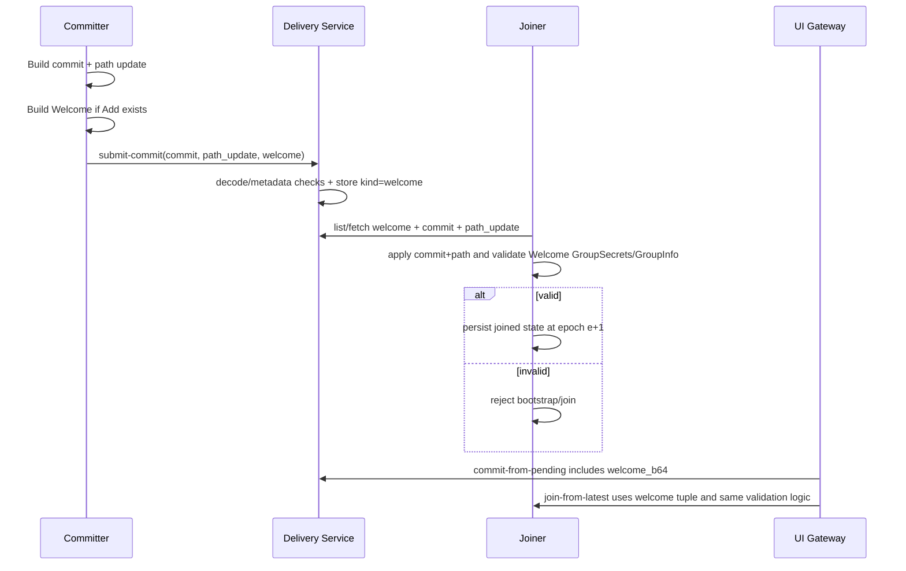

# Welcome Message Lifecycle (Simple View)

## Formal Setup
This page explains the full Welcome lifecycle in your implementation:
- creation during Add-commit generation
- signed DS transport
- recipient decryption and validation
- unknown-group bootstrap from DS streams

Let:
- $g$ be group id.
- $e$ be current epoch before commit.
- $C_e$ be commit at epoch $e$.
- $U_e$ be matched path update for $C_e$.
- $W_{e+1}$ be Welcome created for join epoch $e+1$.
- $\mathcal{A}(C_e)$ be Add keypackages inside $C_e$.
- $\mathrm{GI}_{e+1}$ be GroupInfo embedded in Welcome.
- $\mathrm{GS}_{e+1}$ be GroupSecrets for one joiner.

RFC 9420 Basis:
- Welcome carries encrypted `GroupSecrets` for added members and encrypted `GroupInfo`.
- Joiner must validate Welcome material against local reconstructed post-commit state.

Suspicious Findings:
- `cipher_suite` is currently fixed to `0x0001` in generation and validation.
- `GroupInfo.signature` is filled, but not enforced in joiner validation path.
- Welcome tuple selection in bootstrap uses message-id heuristic before crypto checks.
- DS submit-time Welcome check validates decodability, not full semantic consistency.

## Mathematical Flow
1. Decide whether Welcome is needed
   Inputs: $C_e$
   Outputs: `None` or `W_{e+1}$
   Equation:
   $$
   \mathcal{A}(C_e)=\varnothing \Rightarrow W_{e+1}=\varnothing
   $$
   $$
   \mathcal{A}(C_e)\neq\varnothing \Rightarrow \text{build }W_{e+1}
   $$
   Example: Update-only/Remove-only commits produce no Welcome.
   RFC 9420 Basis: Welcome is tied to Add semantics.
   Suspicious Finding: None.

2. Compute post-commit context for Welcome epoch
   Inputs: $S_e,C_e,U_e$
   Outputs: $\mathrm{CS}_{e+1},\mathrm{DS}_{e+1},h_{e+1}$
   Equation:
   $$
   h_{e+1}=\mathrm{tree\_hash}(\mathrm{ApplyCommit}(T_e,C_e))
   $$
   $$
   \mathrm{CS}_{e+1}=\mathrm{EnsureEpochWithTreeCommitSecret}(e+1,g,h_{e+1},\mathrm{encode}(C_e),\mathrm{tcs}(C_e))
   $$
   $$
   \mathrm{DS}_{e+1}=\mathrm{DeriveEpochSecrets}(\mathrm{CS}_{e+1})
   $$
   Example: Welcome is built from predicted post-commit epoch, not from old epoch state.
   RFC 9420 Basis: Welcome and confirmation material are bound to the next epoch.
   Suspicious Finding: None.

3. Build GroupInfo and encrypt it
   Inputs: $\mathrm{CS}_{e+1},\mathrm{DS}_{e+1},C_e,h_{e+1}$
   Outputs: encrypted GroupInfo payload
   Equation:
   $$
   \mathrm{confirmed\_th}_{e+1}=\mathrm{PredictConfirmedTranscript}(\mathrm{encode}(C_e))
   $$
   $$
   \mathrm{confirmation\_tag}_{e+1}=\mathrm{Tag}(\mathrm{confirmation\_key}_{e+1},\mathrm{confirmed\_th}_{e+1})
   $$
   $$
   \mathrm{GI}_{e+1}=(g,e+1,h_{e+1},\mathrm{confirmed\_th}_{e+1},\mathrm{signer\_leaf},\mathrm{extensions},\mathrm{confirmation\_tag},\mathrm{signature})
   $$
   $$
   \mathrm{enc\_GI}=\mathrm{Enc}(\mathrm{welcome\_secret}_{e+1},\mathrm{ctx}(g,e+1,\mathrm{signer\_leaf}),\mathrm{GI}_{e+1})
   $$
   Example: GroupInfo carries the exact transcript/tree values joiner must match.
   RFC 9420 Basis: GroupInfo encrypted under welcome secret and tied to next epoch context.
   Suspicious Finding: `GroupInfo.signature` is project-specific hash payload and is not enforced during join validation.

4. Build one EncryptedGroupSecrets per added member
   Inputs: $\mathcal{A}(C_e),\mathrm{CS}_{e+1},U_e$
   Outputs: list $\{\mathrm{EGS}_i\}$
   Equation:
   $$
   \mathrm{ref}_i=\mathrm{H}(\text{"WELCOME-KEYPACKAGE-REF"},\mathrm{encode}(KP_i))
   $$
   $$
   \mathrm{GS}_{e+1}^{(i)}=(\mathrm{joiner\_secret}_{e+1},\mathrm{path\_secret}_{opt},\mathrm{psk\_ids})
   $$
   $$
   \mathrm{EGS}_i=\mathrm{EncryptForRecipient}(g,e+1,\mathrm{ref}_i,KP_i.\mathrm{init\_key},\mathrm{GS}_{e+1}^{(i)})
   $$
   Example: each Add target gets a separate encrypted GroupSecrets entry.
   RFC 9420 Basis: Welcome has per-joiner encrypted group secrets.
   Suspicious Finding: implementation uses `path_update.path_secrets.first()` as optional Welcome `path_secret`.

5. Serialize Welcome and include in signed commit submission
   Inputs: $C_e,U_e,W_{e+1}$
   Outputs: DS submit request with optional welcome bytes
   Equation:
   $$
   W_{e+1}=(\mathrm{cipher\_suite},\{\mathrm{EGS}_i\},\mathrm{enc\_GI})
   $$
   $$
   \mathrm{sig\_input}_{commit}=\mathrm{H}_{commit}(C_e)\parallel \mathrm{H}_{path}(U_e)\parallel \mathrm{H}(W_{e+1})
   $$
   Example: CLI `submit-commit` reads `--welcome-file` and includes Welcome hash in commit signing input.
   RFC 9420 Basis: transport-authenticated commit bundle carrying Welcome side payload.
   Suspicious Finding: None.

6. DS validation, storage, and retrieval
   Inputs: submitted commit/path/welcome payloads
   Outputs: stored message rows and retrievable `kind=welcome`
   Equation:
   $$
   \mathrm{Decode}(W_{e+1})=\mathrm{ok}\Rightarrow \mathrm{store\_message}(g,\text{"welcome"},W_{e+1})
   $$
   $$
   \mathrm{list\_messages}(g,\mathrm{kind}=\text{"welcome"})\Rightarrow \{id,\mathrm{kind},\mathrm{size}\}
   $$
   Example: DS stores Welcome as a normal group message with `kind="welcome"` and fetch returns raw bytes.
   RFC 9420 Basis: implementation-specific DS transport layer for MLS artifacts.
   Suspicious Finding: DS only checks that Welcome decodes; deep semantic checks are deferred to joiner.

7. Joiner validation (`join-from-welcome`)
   Inputs: $W_{e+1},C_e,U_e,sk_{joiner},S_{local}^{post-apply}$
   Outputs: accept/reject and joined state
   Equation:
   $$
   \exists \mathrm{EGS}_i:\mathrm{ref}_i\in\mathcal{A}(C_e)\land \mathrm{Dec}(\mathrm{EGS}_i,sk_{joiner})=\mathrm{GS}_{e+1}
   $$
   $$
   \mathrm{GS}_{e+1}.\mathrm{joiner\_secret}=\mathrm{LocalChain.joiner\_secret}_{e+1}
   $$
   $$
   \mathrm{Dec}(\mathrm{enc\_GI},\mathrm{welcome\_secret}_{e+1})=\mathrm{GI}_{e+1}
   $$
   $$
   \mathrm{GI}_{e+1}.(g,e+1,\mathrm{signer},h,\mathrm{confirmed\_th},\mathrm{extensions})=\mathrm{LocalReconstructedState}
   $$
   $$
   \mathrm{VerifyConfirmationTag}(\mathrm{GI}_{e+1})=1
   $$
   Example: any mismatch (group id, epoch, signer, tree hash, transcript hash, confirmation tag, extensions) rejects onboarding.
   RFC 9420 Basis: Welcome joiner checks bind encrypted secrets + GroupInfo to local post-commit reconstruction.
   Suspicious Finding: `GroupInfo.signature` is not part of enforced join acceptance.

8. Unknown-group bootstrap from DS Welcome stream
   Inputs: DS streams (`welcome`,`commit`,`path_update`), base-member keypackages, receiver private key
   Outputs: created local state or failure
   Equation:
   $$
   \mathrm{SelectTuple}=(W_j,C_k,U_m)\;\text{with heuristic }k<j\text{ and path in commit window}
   $$
   $$
   \mathrm{JoinFromTuple}(W_j,C_k,U_m)\land \mathrm{ValidateWelcomeForJoiner}=1 \Rightarrow \mathrm{PersistState}
   $$
   Example: `fetch-and-apply-latest` can build missing local state automatically when no state file exists.
   RFC 9420 Basis: same Welcome+commit+path semantics applied in automated bootstrap loop.
   Suspicious Finding: tuple pre-selection is message-id heuristic before full cryptographic validation.

9. UI lifecycle parity (`commit-from-pending` and `join-from-latest`)
   Inputs: UI action request
   Outputs: welcome generation/transport/join results
   Equation:
   $$
   \mathrm{UICommitFromPending}\Rightarrow \mathrm{welcome\_b64}\;(\text{if Add present})
   $$
   $$
   \mathrm{UIJoinFromLatest}\Rightarrow \mathrm{FindJoinMaterialFromWelcome}\land \mathrm{ValidateWelcomeForJoiner}
   $$
   Example: UI follows the same core Welcome logic as CLI with base64 transport fields.
   RFC 9420 Basis: implementation parity between CLI and UI orchestration layers.
   Suspicious Finding: duplicated CLI/UI Welcome logic can drift unless maintained together.

10. What to Watch (Presentation Callouts)
   Inputs: welcome lifecycle walkthrough output
   Outputs: callout tuple $(\mathrm{checkpoints},\Delta\mathrm{state},\mathrm{suspicious\_summary})$
   Equation:
   $$
   \mathrm{Callout}_{welcome}=(\mathrm{welcome\_created},\mathrm{ds\_stored},\mathrm{joiner\_validated})
   $$
   | What to watch | Expected state delta | Suspicious summary |
   |---|---|---|
   | Add commit produces Welcome with encrypted GroupSecrets + GroupInfo | Welcome bytes appear next to commit/path payloads | `path_secret` comes from first path-secret slot |
   | DS submit/list/fetch for `kind=welcome` works | Welcome is persisted and retrievable by message id | DS validates decode only, not full semantic consistency |
   | Joiner validates Welcome against local post-commit reconstruction | Joiner state is created at epoch `e+1` and can continue sync | `GroupInfo.signature` not enforced; tuple pre-selection uses ID heuristic |
   RFC 9420 Basis: presentation checkpoints over Welcome generation, transport, and safe consumption.
   Suspicious Finding: None (summary step; suspicious items are listed in table).

## Protocol Visual (Mermaid)

## Implementation Traceability
| Symbol/Equation | File:Line | Function Name |
|---|---|---|
| `Welcome` wire object | `src/welcome.rs:24` | `Welcome` |
| `EncryptedGroupSecrets` wire object | `src/welcome.rs:31` | `EncryptedGroupSecrets` |
| `GroupSecrets` wire object | `src/welcome.rs:43` | `GroupSecrets` |
| `GroupInfo` wire object | `src/welcome.rs:51` | `GroupInfo` |
| Welcome encode/decode | `src/welcome.rs:62` | `Welcome::encode` / `Welcome::decode` |
| per-joiner encryption | `src/welcome.rs:104` | `EncryptedGroupSecrets::encrypt_for_recipient` |
| per-joiner decryption | `src/welcome.rs:127` | `EncryptedGroupSecrets::decrypt_group_secrets` |
| GroupInfo encode/decode | `src/welcome.rs:228` | `GroupInfo::encode` / `GroupInfo::decode` |
| create-commit triggers Welcome build | `src/bin/ds_client.rs:1077` | `main` (`CreateCommit`) |
| Welcome builder entry | `src/bin/ds_client.rs:2256` | `build_welcome_for_commit` |
| no-Add -> no Welcome | `src/bin/ds_client.rs:2269` | `build_welcome_for_commit` |
| GroupInfo placeholder signature fill | `src/bin/ds_client.rs:2314` | `build_welcome_for_commit` |
| Welcome path_secret source | `src/bin/ds_client.rs:2333` | `build_welcome_for_commit` |
| generated cipher suite value (`0x0001`) | `src/bin/ds_client.rs:2356` | `build_welcome_for_commit` |
| CLI submit includes optional welcome file | `src/bin/ds_client.rs:700` | `main` (`SubmitCommit`) |
| commit signature binds welcome hash | `src/bin/ds_client.rs:3139` | `commit_signing_input` |
| DS commit endpoint accepts optional welcome | `src/ds/http.rs:800` | `submit_commit` |
| DS stores welcome message | `src/ds/http.rs:937` | `submit_commit` |
| DS commit submit welcome decode check | `src/ds/http.rs:1452` | `parse_and_validate_commit_submission_payload` |
| DS welcome decodability helper | `src/ds/http.rs:1518` | `welcome_payload_is_decodable` |
| DS list supports `kind=welcome` | `src/ds/http.rs:957` | `list_messages` |
| DS fetch returns welcome payload bytes | `src/ds/http.rs:1163` | `fetch_group_message` |
| CLI join-from-welcome validation | `src/bin/ds_client.rs:1817` | `validate_welcome_for_joiner` |
| CLI unknown-group welcome bootstrap loop | `src/bin/ds_client.rs:2847` | `try_bootstrap_unknown_group_from_welcome_once` |
| UI welcome build path | `src/bin/ds_ui_gateway.rs:5716` | `build_welcome_for_commit` |
| UI welcome validation path | `src/bin/ds_ui_gateway.rs:5943` | `validate_welcome_for_joiner` |
| UI find welcome tuple for join | `src/bin/ds_ui_gateway.rs:6242` | `find_join_material_from_welcome` |
| UI commit response includes `welcome_b64` | `src/bin/ds_ui_gateway.rs:6544` | `action_commit_from_pending` |
| DS-backed welcome list/join e2e | `tests/ds_fetch_apply_e2e.rs:1422` | `submit_commit_with_welcome_lists_welcome_kind_end_to_end` |
| DS-backed welcome fetch byte-stability | `tests/ds_fetch_apply_e2e.rs:1731` | `welcome_payload_is_stable_across_ds_submit_and_fetch_roundtrip` |
| DS-backed unknown-group bootstrap | `tests/ds_fetch_apply_e2e.rs:1944` | `fetch_and_apply_latest_bootstraps_unknown_group_from_welcome` |
| DS-backed tampered welcome rejection | `tests/ds_fetch_apply_e2e.rs:2645` | `auto_bootstrap_rejects_tampered_welcome_payload` |
| `SUSPICIOUS: Welcome cipher suite is fixed to 0x0001 in generation` | `src/bin/ds_client.rs:2356` | `build_welcome_for_commit` |
| `SUSPICIOUS: Welcome validation only accepts cipher suite 0x0001` | `src/bin/ds_client.rs:1824` | `validate_welcome_for_joiner` |
| `SUSPICIOUS: GroupInfo signature is generated but not enforced by join validation` | `src/bin/ds_client.rs:2314` | `build_welcome_for_commit` |
| `SUSPICIOUS: path_secret for Welcome uses first path-secret slot` | `src/bin/ds_client.rs:2333` | `build_welcome_for_commit` |
| `SUSPICIOUS: bootstrap tuple pre-selection uses message-id heuristic` | `src/bin/ds_client.rs:2929` | `try_bootstrap_unknown_group_from_welcome_once` |
| `SUSPICIOUS: DS submit validates Welcome decodability, not full semantic consistency` | `src/ds/http.rs:1452` | `parse_and_validate_commit_submission_payload` |
