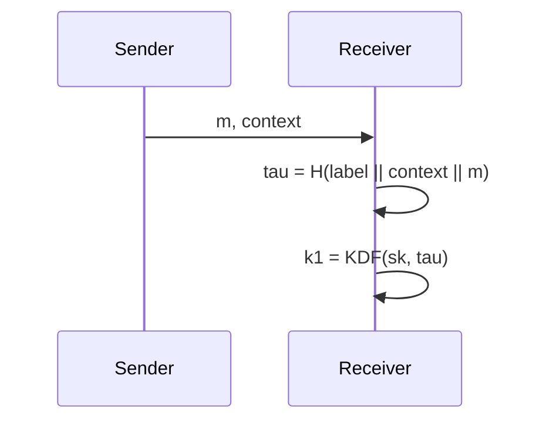

# Protocol Style Guide (Master Template)

This file defines the mandatory style for all future protocol-action documentation.
The target style is academic, math-first, and directly traceable to implementation.

## 0) Grounding Rule (RFC + Code)
- Every statement must be grounded in MLS RFC 9420 semantics and the current codebase behavior.
- For each documented flow step, include the RFC 9420 basis (or explicitly state `No direct RFC step; implementation convenience`).
- If you find anything suspicious (RFC mismatch, ambiguous transition, missing validation, or risky behavior), you must write it explicitly in the explanation.
- Suspicious findings must be traceable to concrete code lines in the `Implementation Traceability` table.

## 1) File Naming & Location Rule
- Every new action document must be created under `/protocol-actions/`.
- File names must use kebab-case from the process name.
- Example: `/protocol-actions/key-derivation.md`.

## 2) Math Standard
- Use LaTeX formatting for all formal notation.
- Use `$$...$$` for block equations.
- Use `$...$` for inline symbols.
- Cryptographic primitives, state transitions, and derivations must be written in mathematical form where applicable.

## 3) Template Structure (Exact)
Every protocol documentation file must contain exactly these 4 sections (no extra top-level sections):

### Formal Setup
- Define primitives and notation (example: let $H$ be SHA-256).
- Define initial state variables and domains.
- State any fixed constants, labels, or contexts.
- State the RFC 9420 basis for this action.
- If applicable, list initial suspicious findings.

### Mathematical Flow
- Provide a numbered step-by-step transformation flow.
- Every step must explicitly list:
  - Inputs
  - Outputs
  - Equation(s)
- Every step must explicitly include:
  - RFC 9420 Basis
  - Suspicious Finding (write `None` if nothing is suspicious)
- Use precise symbol mapping (no ambiguous variable names).

### Protocol Visual (Mermaid)
- Provide one Mermaid.js `sequenceDiagram` that matches the mathematical flow.
- Keep participants and message labels aligned with the symbols used in the equations.
- Use this instead of raw HTML/CSS diagrams.

### Implementation Traceability
- Provide a compact table that maps math to code, and only this:
  - Symbol/Equation
  - File:Line
  - Function Name
- For suspicious findings, add explicit rows prefixed with `SUSPICIOUS:`.

## Minimal Skeleton (Copy/Paste)

````md
# <Action Name>

## Formal Setup
Let $H$ be SHA-256 and let $KDF$ be HKDF-SHA-256.
Let initial state be $S_0 = (\text{group\_id}, \text{epoch}, sk)$.
RFC 9420 Basis: <section(s)>
Suspicious Findings: <None or explicit item(s)>

Example block equation:
$$
\tau = H(\text{label} \parallel \text{context} \parallel m)
$$

## Mathematical Flow
1. Step Name
   Inputs: $m, \text{context}, sk$
   Outputs: $\tau$
   Equation:
   $$
   \tau = H(\text{label} \parallel \text{context} \parallel m)
   $$
   RFC 9420 Basis: <section(s)>
   Suspicious Finding: None

2. Step Name
   Inputs: $\tau, sk$
   Outputs: $k_1$
   Equation:
   $$
   k_1 = KDF(sk, \tau)
   $$
   RFC 9420 Basis: <section(s)>
   Suspicious Finding: None

## Protocol Visual (Mermaid)


## Implementation Traceability
| Symbol/Equation | File:Line | Function Name |
|---|---|---|
| $\tau = H(\text{label} \parallel \text{context} \parallel m)$ | `src/example.rs:42` | `compute_tau` |
| $k_1 = KDF(sk, \tau)$ | `src/example.rs:58` | `derive_stage_key` |
| `SUSPICIOUS: <short description>` | `src/example.rs:99` | `example_fn` |
````
